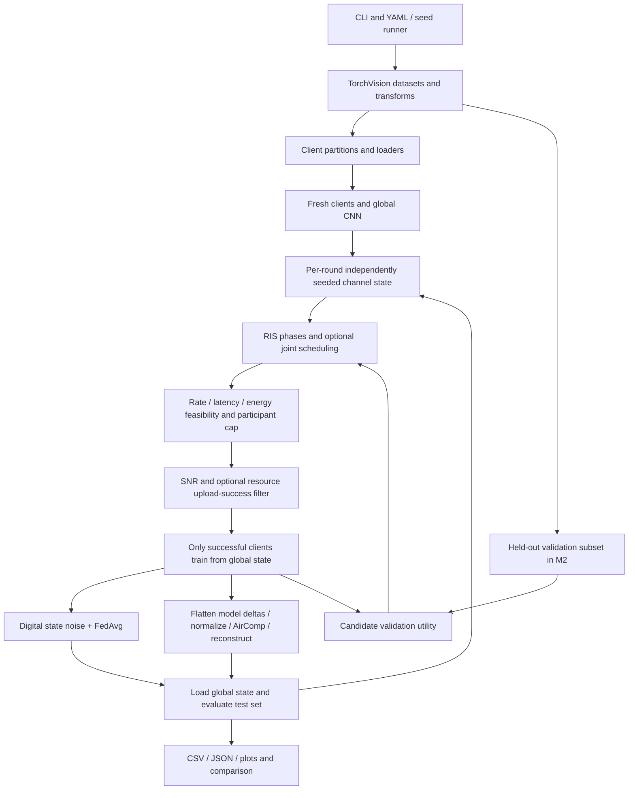

# Comprehensive Technical Code Review and Research Validity Audit

**Repository:** DHYEYDUMASIA24022006/RIS-Assisted-Wireless-Federated-Learning  
**Reviewed branch:** `trial_1`  
**Reviewed commit:** `d52a350fa8fdc802aa46850b4c4f44c9cf4623ab`  
**Review date:** 16 October 2026, Asia/Kolkata  
**Mode:** Review only. No existing project file was edited. Findings describe this immutable snapshot, not other branches or later changes.

## 1. Executive Summary

This repository implements a centralized PyTorch simulation of wireless federated learning: local CNN training, sample-weighted FedAvg, randomly generated fading channels, RIS phase design, resource-aware scheduling, analog model-delta aggregation, logging, and comparison plots. It is more than a channel-only demonstration. Wireless outages actually remove client contributions, and upload noise actually changes model state ([fl/server.py:218–274](https://github.com/DHYEYDUMASIA24022006/RIS-Assisted-Wireless-Federated-Learning/blob/d52a350fa8fdc802aa46850b4c4f44c9cf4623ab/fl/server.py#L218-L274)).

The strongest implementation features are explicit modeled feasibility filtering, a final check after RIS design, independently seeded channel traces across methods, successful-upload participation histories, and a held-out scheduler validation subset. The revised M2 documentation correctly describes its scheduler as a heuristic, not a global optimizer.

**The current implementation is not ready to support robust research performance claims.** The most consequential confirmed problems are:

1. AirComp constrains its inversion coefficient rather than the complete transmitted signal. Sample weighting alone produces a **3.24 W** transmission under a stated **1 W** cap in a reproducible two-client example. Inconsistent weak-channel thresholds permit much larger violations.
2. Simultaneous multi-antenna AirComp is represented using a different client-specific MRC norm for each client, without a realizable common receiver combiner. Synthetic AirComp instead uses an unnormalized antenna sum and the original single-antenna noise power. These are different physical systems.
3. The plot labeled SNR uses `tx_power_dbm = val + 10`, not calibrated received SNR. A point labeled 0 dB produces raw scalar-link SNRs from approximately **−36.52 to 24.53 dB** in one reproduced trace.
4. Default CIFAR-10 model uploads require **79,184,192 bits**. Completing that upload in 100 ms over 10 MHz would require **79.18 bit/s/Hz**, before computation. Ten sampled default channel traces produced no selected clients in the tested balanced-size scheduling scenario. This is a demonstrated feasibility concern, not a completed default FL experiment or a proof over every fading realization.
5. Digital and analog quantities both called aggregation MSE have different definitions. Cross-method plots also contain confirmed curve-selection and labeling errors.
6. Some ablations retain the supposedly removed history in tie-breaking; configuration advertises unsupported controls; IID allocation loses remainder samples.

Lightweight tests passed for channel dimensions, basic rate/noise conversions, fixed-seed channel repeatability, a normal-scale sum-gain RIS improvement, noiseless weighted analog arithmetic, feasible/infeasible scheduler decisions, and partition uniqueness. Several tests intentionally reproduced defects. **No PyTorch training or tensor integration test ran:** neither available Python environment had PyTorch. No dataset was downloaded and no long experiment was launched. Numerical observations in this report are synthetic audit evidence, not reported learning improvements.

## 2. Project Overview

The intended problem is uplink learning with a multi-antenna base station, a passive RIS, and single-antenna clients. The RIS changes effective channel gains. Device scheduling seeks useful and fairly distributed uploads within modeled per-device energy and latency limits. The analog branch attempts to exploit simultaneous signal superposition to estimate a sample-weighted model update.

The executable stack is Python, PyTorch/TorchVision, NumPy, PyYAML, tqdm, Matplotlib, Seaborn, and pandas. [requirements.txt:1–12](https://github.com/DHYEYDUMASIA24022006/RIS-Assisted-Wireless-Federated-Learning/blob/d52a350fa8fdc802aa46850b4c4f44c9cf4623ab/requirements.txt#L1-L12) additionally lists Flower, SciPy, CVXPY, and scikit-learn; no Python source imports those four packages. There is no Flower deployment, CVXPY solver, distributed radio implementation, hardware testbed, or packet-level link simulator. MATLAB provides a separate offline channel generator. The source uses Python 3.10-era type syntax, matching the README's Python 3.10+ requirement.

Primary sources consulted for context: [McMahan et al., FedAvg](https://proceedings.mlr.press/v54/mcmahan17a.html) introduces iterative local model averaging; [Wu and Zhang, RIS beamforming](https://arxiv.org/abs/1810.03961) studies coupled active/passive beamforming; [Power-Efficient Over-the-Air Aggregation with Receive Beamforming](https://arxiv.org/html/2501.18058v1) explicitly considers multi-antenna receive design. These establish context, not a claim that this code reproduces any paper. The mathematical findings below follow directly from the inspected implementation and independently derived signal equations.

## 3. Repository Architecture

### 3.1 Discovery and provenance

The initially open workspace was `/Users/amrit/Desktop/consultify`, remote `amriiit/consultify`, branch `main`, commit `30cb6f6cb618da6346a61c88814d4aa93431452a`. It contained four pre-existing modified JavaScript files. It was not used as the audit target. The requested repository was cloned separately into `/private/tmp/ris-research-audit`, and its branch, commit, remote, and clean status were verified before inspection. The target has **35 tracked files**, including **24 Python files**, two YAML files, one MATLAB file, and five Markdown documents. No applicable `AGENTS.md`, existing tests, CI workflow, lockfile, or committed results were present in the reviewed tree.

The repository contains `channel/`, `fl/`, `optimisation/`, `experiments/`, `analysis/`, `metrics/`, `utils/`, `config/`, `matlab/`, and `docs/`. Data and generated results are ignored by Git. Absence of committed results means this snapshot supplies implementation evidence, not independently inspectable final accuracy evidence.

### 3.2 File-level responsibility matrix

| File | Responsibility / entry points | Inputs → outputs and observations |
|---|---|---|
| `main.py` | YAML loading, seed/device setup, CLI routing, quick configuration | Config/CLI → experiment runs; `all` adds comparison generation |
| `run_full_evaluation.py` | Independent-seed execution, optional CPU process pool, numeric summary collection | Config/seeds → per-seed folders and aggregate JSON; not a plotting confidence-interval pipeline |
| `channel/channel_model.py` | `WirelessChannel`; fading, path loss, effective channel, SNR/rate | Config + phases → complex vectors, idealized rates |
| `channel/ris_optimizer.py` | `RISOptimizer`; sum-gain coordinate ascent, worst-user and inverse-gain heuristics | Channels → continuous unit-modulus phases |
| `fl/models.py` | `MNISTNet`, `CIFAR10Net`, factory | Images → ten logits; CIFAR model has BatchNorm and dropout |
| `fl/data_partition.py` | Dataset download/transforms, IID/Dirichlet splits, validation split, loaders | TorchVision datasets → index maps / loaders |
| `fl/client.py` | `FLClient.train`; local SGD | Global state → local state, sample count, local loss; optimizer recreated each call |
| `fl/server.py` | `FLServer.run`; resources, outage, training, utility, aggregation, evaluation | Clients/channel/RIS/selector → state updates and per-round metrics |
| `fl/aircomp.py` | `AirCompAggregator.aggregate`, normalized error, separate power helper | Real vectors, scalar channels, noise, weights → noisy weighted mean |
| `optimisation/joint_design.py` | `JointDeviceRISOptimizer`; history/priority and feasibility-first alternating selection | Channels, sizes, CPU capacities → selected indices and RIS phases |
| `optimisation/baselines.py` | Random, channel-only, nominal fixed-RIS selectors | SNRs/cap → indices; common server paths bypass these objects for named strategies |
| `experiments/exp1_baseline.py` | Four-condition digital FL comparison | Shared partition/seed → CSV, summaries, six plots |
| `experiments/exp2_joint_design.py` | Seven M2 strategies/ablations, budget sweeps | Held-out validation + budgets → logs, summary, saved input config, four plot families |
| `experiments/exp3_aircomp.py` | Synthetic N/SNR sweeps and five FL methods across heterogeneity | Synthetic gradients / client data → error curves, learning logs, summary, five plots |
| `analysis/compare_methods.py` | Load summary/CSV artifacts; combined tables/plots | Existing outputs → comparison files; filename heuristics are unreliable |
| `metrics/metrics_logger.py` | Schema, per-round CSV, per-run JSON means | Server scalar logs → artifacts; several schema fields remain null |
| `utils/plotting.py` | Figure saving/fallback and generic plot helpers | Data/figure → files; only `save_figure` is used by experiments |
| `matlab/channel_gen.m` | Independent Rician/Rayleigh `.mat` generator | MATLAB parameters → channel tensors; not consumed by Python |
| `config/config.yaml` | Main CIFAR-10 scenario | 20 clients, 200 rounds, five local epochs, 64 RIS elements, 100 ms / 50 mJ |
| `config/config_fast.yaml` | MNIST CPU scenario | Ten clients, 50 rounds, two local epochs, same hard budgets; skips M2 sweeps |
| `requirements.txt` | Lower-bound package list | Unpinned dependency resolution, no environment lock |
| `README.md` | Architecture, claims, usage | Includes inconsistent matrix convention and placeholder clone URL |
| `docs/M2_METHODOLOGY.md` | Revised M2 algorithm and caveats | Best explanation of intended heuristic and simulated resource limits |
| `docs/RUNBOOK.md` | Windows execution and evidence steps | Explicitly distinguishes smoke runs from final study |
| `docs/RUN_GUIDE_UNIVERSITY.md` | Ubuntu/GPU instructions | Refers to another branch; single-branch clone directions need correction |
| `docs/REVIEW_EVIDENCE_PLAN.md` | Assessment/evidence plan | Planned evidence is not evidence already generated |
| Seven `__init__.py` files | Package markers/exports | `channel` and `fl` re-export classes; `fl` eagerly imports TorchVision-dependent code |
| `.gitignore`, `LICENSE` | Ignore generated artifacts; MIT license | No executable algorithm |

### 3.3 End-to-end workflow



The successful-upload filter precedes training. Failed clients never execute local SGD, though scheduled-failure resource estimates include their modeled computation. That is a simulation shortcut, not the causal sequence of actual train-then-upload devices. Global state is retained if there is no successful update ([fl/server.py:238–281](https://github.com/DHYEYDUMASIA24022006/RIS-Assisted-Wireless-Federated-Learning/blob/d52a350fa8fdc802aa46850b4c4f44c9cf4623ab/fl/server.py#L238-L281)).

## 4. Implementation Breakdown

### 4.1 Channel and RIS components

`WirelessChannel` accepts nested or flat channel config. It samples user distances, one BS–RIS matrix, per-user RIS channels, and per-user direct links every round ([channel/channel_model.py:219–240](https://github.com/DHYEYDUMASIA24022006/RIS-Assisted-Wireless-Federated-Learning/blob/d52a350fa8fdc802aa46850b4c4f44c9cf4623ab/channel/channel_model.py#L219-L240)). Direct blockage is independently sampled and applies additional attenuation to power gain. Only BS–RIS uses the configurable Rician model; both user-link types remain Rayleigh regardless of the `model` setting ([channel/channel_model.py:97–161](https://github.com/DHYEYDUMASIA24022006/RIS-Assisted-Wireless-Federated-Learning/blob/d52a350fa8fdc802aa46850b4c4f44c9cf4623ab/channel/channel_model.py#L97-L161)).

`RISOptimizer` precomputes per-user contributions `A_k = H * h_RU,k` by column broadcast. Every optimization call starts from new random phases; joint alternation does not warm-start the previous phase vector. The sum mode optimizes a weighted sum of channel squared norms. The other modes change the target user or inverse-gain weights at each element; neither solves a rigorously stated max-min/MSE subproblem.

### 4.2 FL training and data

MNIST uses two convolutions and two fully connected layers. CIFAR-10 uses three convolution/BatchNorm blocks, a 4096-to-512 dense layer, dropout, and a ten-class output ([fl/models.py:7–48](https://github.com/DHYEYDUMASIA24022006/RIS-Assisted-Wireless-Federated-Learning/blob/d52a350fa8fdc802aa46850b4c4f44c9cf4623ab/fl/models.py#L7-L48)). The manually calculated trainable parameter counts are 225,034 and 2,474,506 respectively.

Clients load the global state at each successful training event and execute SGD with momentum, configured weight decay, and `lr * lr_decay**round_idx` ([fl/client.py:24–59](https://github.com/DHYEYDUMASIA24022006/RIS-Assisted-Wireless-Federated-Learning/blob/d52a350fa8fdc802aa46850b4c4f44c9cf4623ab/fl/client.py#L24-L59)). Momentum state resets each call; that is a legitimate local-optimizer convention but should be disclosed. Local loss is a mean of batch means rather than a sample-weighted loss; returned local loss is not passed into the logger.

FedAvg weights complete client states by local dataset size among **successful** clients. This is not an unbiased estimate of all-client learning when success depends on channel/data properties. Held-out test examples do not enter local training. M2 additionally reserves validation indices using a local NumPy generator and deterministic evaluation transforms ([fl/data_partition.py:108–153](https://github.com/DHYEYDUMASIA24022006/RIS-Assisted-Wireless-Federated-Learning/blob/d52a350fa8fdc802aa46850b4c4f44c9cf4623ab/fl/data_partition.py#L108-L153)); its scheduler uses only a capped subset of those held-out examples. No test leakage into priority feedback was found.

### 4.3 Joint scheduling

The scheduler tracks EMA validation improvement, cumulative successful-upload counts, selection counts, and capped age since success ([optimisation/joint_design.py:58–78](https://github.com/DHYEYDUMASIA24022006/RIS-Assisted-Wireless-Federated-Learning/blob/d52a350fa8fdc802aa46850b4c4f44c9cf4623ab/optimisation/joint_design.py#L58-L78)). Ranks are normalized into [0,1]; a tied entire signal returns ones, whereas ties inside a varying signal receive average ranks. Priorities combine utility, negative success count, and age with normalized nonnegative weights.

It first designs priority-weighted phases for all clients, filters modeled feasibility, ranks feasible clients, redesigns phases for the selected set, and repeats. It stops when the selected list stabilizes or the iteration cap is reached. It recomputes feasibility and fills available slots under the final fixed phases ([optimisation/joint_design.py:99–133](https://github.com/DHYEYDUMASIA24022006/RIS-Assisted-Wireless-Federated-Learning/blob/d52a350fa8fdc802aa46850b4c4f44c9cf4623ab/optimisation/joint_design.py#L99-L133)). The server independently recomputes resource feasibility. These are useful safeguards: no forced infeasible fallback was found in the standard M2 path.

Cold-start utility is zero and only observed successful clients gain measurements. Debt and age cannot guarantee participation for perpetually infeasible clients. There is no exploration guarantee, global loss-optimality result, or full resource-allocation optimization. CSI and utility feedback acquisition overhead are unmodeled.

### 4.4 AirComp and outputs

Server AirComp flattens all floating state entries, subtracts global values, computes sample weights, divides by one global peak delta when normalization is enabled, calls the scalar aggregator, rescales, and reconstructs floating states ([fl/server.py:419–455](https://github.com/DHYEYDUMASIA24022006/RIS-Assisted-Wireless-Federated-Learning/blob/d52a350fa8fdc802aa46850b4c4f44c9cf4623ab/fl/server.py#L419-L455)). Nonfloating state remains copied from the global state. This differs from FedAvg's float conversion and averaging of all state entries.

MetricsLogger writes per-run CSV and summary JSON. Experiment 2 additionally saves the **input** config, not all per-strategy overrides; neither the other experiments nor the seed runner saves a complete resolved run manifest. [run_full_evaluation.py:64–78](https://github.com/DHYEYDUMASIA24022006/RIS-Assisted-Wireless-Federated-Learning/blob/d52a350fa8fdc802aa46850b4c4f44c9cf4623ab/run_full_evaluation.py#L64-L78) averages numeric summary fields with population standard deviation (`ddof=0`), skipping booleans, lists, and nonfinite values. It does not average learning curves or generate uncertainty bands. Process pooling operates over seeds, not clients.

## 5. Mathematical and Algorithmic Correctness

### 5.1 Wireless channel equations and units

Implemented dimensions are `H ∈ C^(M×N)`, `r_k ∈ C^(N×1)`, `d_k ∈ C^(M×1)`, `phi ∈ C^N`, with

\[
h_k=H\operatorname{diag}(\phi)r_k+d_k.
\]

This is dimensionally correct and agrees with the optimizer. README instead calls `H_BR` an N×M matrix and uses its Hermitian transpose. Either convention can be valid if consistently defined; the implementation is internally consistent. The defect is in the documented correspondence, not proof of a missing conjugation in executing Python ([README.md:41–48](https://github.com/DHYEYDUMASIA24022006/RIS-Assisted-Wireless-Federated-Learning/blob/d52a350fa8fdc802aa46850b4c4f44c9cf4623ab/README.md#L41-L48); [channel/channel_model.py:8–11](https://github.com/DHYEYDUMASIA24022006/RIS-Assisted-Wireless-Federated-Learning/blob/d52a350fa8fdc802aa46850b4c4f44c9cf4623ab/channel/channel_model.py#L8-L11); [channel/channel_model.py:173–185](https://github.com/DHYEYDUMASIA24022006/RIS-Assisted-Wireless-Federated-Learning/blob/d52a350fa8fdc802aa46850b4c4f44c9cf4623ab/channel/channel_model.py#L173-L185)). MATLAB exports M×N matrices too.

Rayleigh samples use `(x + j*y)/sqrt(2)`, giving unit mean squared magnitude before path loss. Rician samples mix a unit-magnitude steering outer product and unit-variance diffuse fading using square-root K factors. K is correctly converted from dB to linear. Half-wavelength ULA steering is conventional. Path loss is a **power gain** `beta=(lambda/(4*pi*d0))²*(d/d0)^(-alpha)` and amplitudes are multiplied by `sqrt(beta)`. GHz-to-wavelength, MHz-to-Hz, dBm-to-W, and PSD integration are internally correct ([channel/channel_model.py:34–57](https://github.com/DHYEYDUMASIA24022006/RIS-Assisted-Wireless-Federated-Learning/blob/d52a350fa8fdc802aa46850b4c4f44c9cf4623ab/channel/channel_model.py#L34-L57); [channel/channel_model.py:73–122](https://github.com/DHYEYDUMASIA24022006/RIS-Assisted-Wireless-Federated-Learning/blob/d52a350fa8fdc802aa46850b4c4f44c9cf4623ab/channel/channel_model.py#L73-L122)).

At −174 dBm/Hz and 10 MHz, implemented thermal noise is **3.981071705534986e−14 W**. `SNR=P||h||²/noise` and `R=B log2(1+SNR)` are valid idealized single-user formulas assuming unit-norm MRC, white receiver noise, and no interference. Shannon capacity is an upper bound, not validated application throughput. There is no noise figure, coding overhead, pilot cost, interference, bandwidth allocation, or finite-blocklength model.

Distances to the BS and RIS are drawn independently; with BS–RIS distance 20 m, a user can be sampled 150 m from the BS and at most 50 m from the RIS, violating triangle geometry. Treat this as a stochastic link-budget abstraction, not a spatially consistent deployment. Distances, directions, and blockage redraw each round, so clients effectively change large-scale channels rather than remaining at fixed positions. The RIS model has ideal passive phases without element area, loss, quantization, or electromagnetic coupling. Increasing N is not a fixed-aperture physical study.

### 5.2 RIS coordinate derivation and limitations

For one coordinate, let `h_k=b_k+a_k*phi_n`. Then

\[
\sum_k q_k\|h_k\|^2=C+2\Re\left\{\phi_n^*\sum_k q_k a_k^H b_k\right\}.
\]

For fixed nonnegative weights, the correct maximizer is `phi_n=v/|v|`, where `v=sum(q_k*a_k^H*b_k)`. `np.vdot(a,b)` implements the required conjugation. The sum mode therefore has the correct phase sign and preserves unit modulus ([channel/ris_optimizer.py:123–135](https://github.com/DHYEYDUMASIA24022006/RIS-Assisted-Wireless-Federated-Learning/blob/d52a350fa8fdc802aa46850b4c4f44c9cf4623ab/channel/ris_optimizer.py#L123-L135)). It is coordinate ascent on weighted sum channel gain, proportional to sum SNR only under common transmit power/noise. It is not direct FL loss minimization or sum-rate maximization. Local stationary behavior is not global optimality.

The `1e-15` absolute cutoff introduces dependence on physical scaling. A reproduced one-element example at 1e−9 amplitude never updates even though a better phase exists; at ordinary configured channel scale, the tested 20-user sum objective did improve from **1.96568e−9 to 2.38371e−9**. Thus the optimizer must not be dismissed as universally inactive. Convergence uses phase-vector difference, not objective improvement; it can report immediate stopping after all updates are suppressed and does not certify the advertised objective ([channel/ris_optimizer.py:182–185](https://github.com/DHYEYDUMASIA24022006/RIS-Assisted-Wireless-Federated-Learning/blob/d52a350fa8fdc802aa46850b4c4f44c9cf4623ab/channel/ris_optimizer.py#L182-L185)).

Worst-user coordinate alignment can hurt another user enough to lower the minimum. A reproduced one-step counterexample decreases minimum gain **1.25845 → 0.325086**. Inverse-gain weighted alignment is explicitly a heuristic in the code and is not guaranteed to reduce spread, worst-user noise amplification, or aggregate MSE ([channel/ris_optimizer.py:137–180](https://github.com/DHYEYDUMASIA24022006/RIS-Assisted-Wireless-Federated-Learning/blob/d52a350fa8fdc802aa46850b4c4f44c9cf4623ab/channel/ris_optimizer.py#L137-L180)). Neither mode includes objective acceptance or rollback. Quantization and SCA are absent.

### 5.3 FedAvg, model state, and digital noise

The successful-client floating-parameter average is correct:

\[
w_{t+1}=\sum_{k\in S_{success}}\frac{n_k}{\sum_{i\in S_{success}}n_i}w_{k,t+1}.
\]

For states `[1,3]`, `[5,7]` and counts 1,3, the source method yields `[4,6]` using NumPy tensor stand-ins. This verifies arithmetic only, not PyTorch behavior.

All state entries are converted to float, including integer BatchNorm counters, producing a fractional counter before `load_state_dict` casts it back. Analog aggregation instead leaves those counters unchanged. A deliberate BatchNorm policy is needed rather than treating counters as learned real-valued parameters ([fl/server.py:475–495](https://github.com/DHYEYDUMASIA24022006/RIS-Assisted-Wireless-Federated-Learning/blob/d52a350fa8fdc802aa46850b4c4f44c9cf4623ab/fl/server.py#L475-L495); [fl/server.py:419–455](https://github.com/DHYEYDUMASIA24022006/RIS-Assisted-Wireless-Federated-Learning/blob/d52a350fa8fdc802aa46850b4c4f44c9cf4623ab/fl/server.py#L419-L455)). Weighted BN running statistics are a heuristic and need not equal pooled global statistics.

Digital upload impairment adds absolute Gaussian noise to every floating state tensor, including BN running means and variances ([fl/server.py:457–473](https://github.com/DHYEYDUMASIA24022006/RIS-Assisted-Wireless-Federated-Learning/blob/d52a350fa8fdc802aa46850b4c4f44c9cf4623ab/fl/server.py#L457-L473)). The perturbation can make running variances negative and produce invalid evaluation; this consequence was not executed without PyTorch. It is not a digital coded link model: successful digital packets ordinarily recover encoded values, whereas this code combines hard outages and analog-style real-valued state corruption. If retained, it must be described as an artificial parameter-noise stress model and its scale justified.

### 5.4 Resource feasibility and fairness

Both scheduler and server use, with unit conversions shown,

\[
T_k=1000\left(\frac{n_k E c}{f_k}+\frac{D}{R_k}\right)\;\mathrm{ms},\quad
E_k=P\frac{D}{R_k}1000+n_kE e_{sample}\;\mathrm{mJ}.
\]

The formulas agree in the normal Hz-valued server path ([optimisation/joint_design.py:159–177](https://github.com/DHYEYDUMASIA24022006/RIS-Assisted-Wireless-Federated-Learning/blob/d52a350fa8fdc802aa46850b4c4f44c9cf4623ab/optimisation/joint_design.py#L159-L177); [fl/server.py:364–375](https://github.com/DHYEYDUMASIA24022006/RIS-Assisted-Wireless-Federated-Learning/blob/d52a350fa8fdc802aa46850b4c4f44c9cf4623ab/fl/server.py#L364-L375)). `cycles_per_sample=20` is neither a measured CNN training cost nor interchangeable with FLOPs. Multiplying by local epochs is correct, but backpropagation, optimizer operations, validation, downlink, RIS/CSI signaling, and server time are omitted. Capacity values at or below 1e6 are silently replaced by configured CPU frequency in the standalone scheduler; that behavior needs an explicit unit contract.

Default CIFAR upload requires about 238.37 dB SNR to meet the 100 ms communication-only budget under the Shannon formula. The 50 mJ budget alone permits at most about 250.59 ms communication at 23 dBm even before computation. For 2375 samples and five epochs, computation energy is 11.875 mJ. The observed default trace minimum total latency was 643.98 ms and minimum energy 140.32 mJ. Gaussian fading is unbounded, so this is a severe practical mismatch, not a theorem that selection is impossible for every realization.

For digital clients, all receive the full bandwidth and per-round latency is the maximum individual time. That assumes unconstrained parallel orthogonal links (or omitted multiuser allocation) and omits aggregate bandwidth/interference constraints ([fl/server.py:164–172](https://github.com/DHYEYDUMASIA24022006/RIS-Assisted-Wireless-Federated-Learning/blob/d52a350fa8fdc802aa46850b4c4f44c9cf4623ab/fl/server.py#L164-L172); [fl/server.py:301–302](https://github.com/DHYEYDUMASIA24022006/RIS-Assisted-Wireless-Federated-Learning/blob/d52a350fa8fdc802aa46850b4c4f44c9cf4623ab/fl/server.py#L301-L302)). It cannot substantiate digital-versus-AirComp communication savings. AirComp still uses the same digital model-bits/Shannon-rate resource accounting even though analog airtime should derive from symbol count/bandwidth and receiver design.

Jain fairness uses cumulative actual selected/successful counts, not dataset sizes; all-zero histories return zero by convention ([fl/server.py:403–408](https://github.com/DHYEYDUMASIA24022006/RIS-Assisted-Wireless-Federated-Learning/blob/d52a350fa8fdc802aa46850b4c4f44c9cf4623ab/fl/server.py#L403-L408)). It does not measure accuracy fairness, utility fairness, or service to feasible clients conditional on opportunity. Neither debt nor age can guarantee starvation prevention under infeasibility.

### 5.5 AirComp signal derivation

The aggregator implements

\[
\eta=P_{max}\min_{k:\,|h_k|^2>10^{-20}}|h_k|^2,\quad b_k=\sqrt{\eta}/h_k,
\]
\[
x_k=K w_k s_k b_k,\quad y=\sum_k h_k x_k+n,\quad
\hat s=\Re(y)/(K\sqrt{\eta}).
\]

For valid nonzero channels with no noise, recovery is exactly `sum(w_k*s_k)`. The arithmetic test confirms this. But actual average transmit power is

\[
\mathbb E|x_k|^2=\frac{\eta}{|h_k|^2}(K w_k)^2\mathbb E|s_k|^2.
\]

The implementation constrains only the first factor. Even peak normalization `|s_k|≤1` does not remove `(K*w_k)²`; unnormalized Gaussian synthetic vectors also do not have bounded peak amplitude or guaranteed finite-trial power ≤1. A correct average-power eta must include the complete symbol energy and weight, for example `eta ≤ min_k Pmax*|h_k|²/((K*w_k)²*v_k)` for symbol second moment `v_k>0`. A peak-power formulation instead requires a maximum-amplitude term. These definitions must be chosen explicitly.

Gain thresholds are inconsistent: the eta minimum excludes squared magnitudes ≤1e−20, while inversion accepts magnitudes >1e−12 ([fl/aircomp.py:44–60](https://github.com/DHYEYDUMASIA24022006/RIS-Assisted-Wireless-Federated-Learning/blob/d52a350fa8fdc802aa46850b4c4f44c9cf4623ab/fl/aircomp.py#L44-L60)). With gains `1e−11` and `1`, eta uses only the strong channel; the weak channel still inverts, producing coefficient power **1e22** for Pmax=1. Exact zero channels contribute nothing but retain their sample weights in the desired aggregate. With two identical unit updates and gains `[0,1]`, the returned mean is 0.5 instead of 1. All-zero channels return zeros without failure status.

Receiver noise is circular complex with real-coordinate variance `noise_power/2`. Returning only the real part is appropriate for the chosen real symbols, giving post-recovery real noise variance `noise_power/(2*K²*eta)` under the scalar assumptions. Noiseless exactness is not proof of physical validity.

For simultaneous multi-antenna uplink, a single combiner `u` gives scalar channels `u^H h_k` and noise variance `sigma²||u||²`. The server substitutes `||h_k||` separately for every client ([fl/server.py:173–174](https://github.com/DHYEYDUMASIA24022006/RIS-Assisted-Wireless-Federated-Learning/blob/d52a350fa8fdc802aa46850b4c4f44c9cf4623ab/fl/server.py#L173-L174)), which requires independent matched combiners and is generally unrealizable as one shared superposition. For orthogonal unit channels `[1,0]` and `[0,1]`, no unit combiner yields both gains 1. The synthetic sweep instead takes `sum(h_k)` and keeps noise at sigma² ([experiments/exp3_aircomp.py:286–298](https://github.com/DHYEYDUMASIA24022006/RIS-Assisted-Wireless-Federated-Learning/blob/d52a350fa8fdc802aa46850b4c4f44c9cf4623ab/experiments/exp3_aircomp.py#L286-L298)); an all-ones combiner has norm squared M and requires M*sigma² noise. Moreover, `[1,−1]` has zero summed gain but nonzero norm sqrt(2). The two paths are not equivalent.

The reported analog error is normalized squared vector error relative to the exact **successful-subset** update. It excludes missing-client bias and becomes denominator-sensitive for near-zero true aggregates. The digital metric is the mean of per-upload elementwise state-noise powers, before averaging; for independent uploads aggregate error would involve squared sample weights. These are not interchangeable metrics.

## 6. Experiment-by-Experiment Review

### 6.1 Experiment 1 — digital FL with and without RIS

Four conditions are genuinely implemented: ideal, fading/no RIS, random RIS, optimized RIS ([experiments/exp1_baseline.py:113–164](https://github.com/DHYEYDUMASIA24022006/RIS-Assisted-Wireless-Federated-Learning/blob/d52a350fa8fdc802aa46850b4c4f44c9cf4623ab/experiments/exp1_baseline.py#L113-L164)). They share one partition and identical per-condition seeds and model construction order. Independent channel RNG state in the server gives paired channel traces even when optimizers draw different random numbers. Learning rate and model architecture match. Experiment 1 forces `fraction_fit=1`, disables resource enforcement and rate outages, and uses SNR filtering plus upload noise.

Controls are useful but incomplete. Shared global Torch RNG means differing success counts, upload-noise draws, and dropout/augmentation operations change later minibatch and stochastic-training sequences. Identical seed does not imply paired per-client data orders. This is stochastic variance, not proof of intentional unfairness; independent per-client RNG streams would make the causal comparison cleaner. The ideal model is a noise-free reference, not a mathematical upper bound on stochastic test accuracy. It is allowed arbitrary infinite-like rate/SNR placeholders and does not test the same physical budget.

An explicit configured participant cap is retained despite the claim every client attempts upload; `max_participants` can therefore truncate the all-client path ([experiments/exp1_baseline.py:51–58](https://github.com/DHYEYDUMASIA24022006/RIS-Assisted-Wireless-Federated-Learning/blob/d52a350fa8fdc802aa46850b4c4f44c9cf4623ab/experiments/exp1_baseline.py#L51-L58); [fl/server.py:182–206](https://github.com/DHYEYDUMASIA24022006/RIS-Assisted-Wireless-Federated-Learning/blob/d52a350fa8fdc802aa46850b4c4f44c9cf4623ab/fl/server.py#L182-L206)). The provided configs leave it null, so this does not affect the standard condition setup.

Convergence and successful-upload plots reflect their logged values. The SNR CDF is a CDF of per-round means, not the distribution of every link. The ideal placeholder is exactly 100 dB; `not all(s > 100 ...)` fails to exclude it ([experiments/exp1_baseline.py:259–266](https://github.com/DHYEYDUMASIA24022006/RIS-Assisted-Wireless-Federated-Learning/blob/d52a350fa8fdc802aa46850b4c4f44c9cf4623ab/experiments/exp1_baseline.py#L259-L266)). The rounds-to-target bar substitutes the final round when the target is not reached, making censoring look like attainment ([experiments/exp1_baseline.py:242–254](https://github.com/DHYEYDUMASIA24022006/RIS-Assisted-Wireless-Federated-Learning/blob/d52a350fa8fdc802aa46850b4c4f44c9cf4623ab/experiments/exp1_baseline.py#L242-L254)). The error plot is upload parameter noise, not aggregate-versus-FedAvg MSE. No seed uncertainty is drawn.

### 6.2 Experiment 2 — joint scheduling and RIS design

Seven methods are present: proposed, no utility, no upload debt, no starvation age, channel-only without RIS, random without RIS, and channel ranking with random RIS ([experiments/exp2_joint_design.py:113–121](https://github.com/DHYEYDUMASIA24022006/RIS-Assisted-Wireless-Federated-Learning/blob/d52a350fa8fdc802aa46850b4c4f44c9cf4623ab/experiments/exp2_joint_design.py#L113-L121)). Shared partitions, model initialization order, validation holdout, channel traces, budget overrides, and standard positive caps are matched. Every M2 run enables resource filtering ([experiments/exp2_joint_design.py:303–344](https://github.com/DHYEYDUMASIA24022006/RIS-Assisted-Wireless-Federated-Learning/blob/d52a350fa8fdc802aa46850b4c4f44c9cf4623ab/experiments/exp2_joint_design.py#L303-L344)). The server's separate feasibility check supports the hard modeled constraints.

The major validity problem is operating point selection: a 79.2 Mbit CIFAR upload under 100 ms / 50 mJ makes the tested default scenario idle. The 50–200 ms latency sweep and energy sweep at fixed 100 ms may remain dominated by the other infeasible constraint. These sweeps cannot distinguish learning-aware scheduling when virtually nobody participates. Before training, measure the distribution of feasible counts and choose disclosed feasible/intermediate/outage-heavy regimes.

There is also an attribution gap: all joint variants use optimized RIS, but no non-joint scheduling baseline uses the same optimized RIS. Thus gains over random-RIS/no-RIS methods combine RIS improvement and scheduling changes. Add random and channel-only scheduling under the same optimized RIS design. A random baseline is sampled **among feasible clients**, not unconstrained random scheduling, which is appropriate for matched hard constraints but should be stated.

Debt and age zero-weight ablations are incomplete because those signals remain in sorting tie-breaks. Random RIS is redrawn every round despite the methodology describing fixed random phases. Utility validation requires candidate model construction and inference for each successful upload and a baseline model, yet none of this overhead enters the resource comparison. The validation model constructor also consumes global Torch RNG and can alter later data shuffles relative to baselines without utility evaluation ([fl/server.py:243–255](https://github.com/DHYEYDUMASIA24022006/RIS-Assisted-Wireless-Federated-Learning/blob/d52a350fa8fdc802aa46850b4c4f44c9cf4623ab/fl/server.py#L243-L255); [fl/server.py:388–401](https://github.com/DHYEYDUMASIA24022006/RIS-Assisted-Wireless-Federated-Learning/blob/d52a350fa8fdc802aa46850b4c4f44c9cf4623ab/fl/server.py#L388-L401)).

Latency sweeps store final accuracy; energy sweeps store average **scheduled** count, not successful uploads. Only fixed-budget runs save per-round logs, so sweeps lose feasibility/error trajectories ([experiments/exp2_joint_design.py:174–226](https://github.com/DHYEYDUMASIA24022006/RIS-Assisted-Wireless-Federated-Learning/blob/d52a350fa8fdc802aa46850b4c4f44c9cf4623ab/experiments/exp2_joint_design.py#L174-L226)). Idle rounds appear as zero latency in the CDF. The saved input config does not explicitly serialize each ablation's resolved normalized weights or the forced flags. No actual CIFAR training results were audited.

### 6.3 Experiment 3 — synthetic and FL AirComp

Synthetic sweeps use 1000-dimensional iid standard-normal vectors, all K clients, uniform weights, 20 optimizer iterations, and no upload-success filter. Only one RIS-assisted method is plotted; no no-RIS or random-RIS synthetic curve is generated. Samples at different sweep points are fresh channels and gradients, without paired controls, per-trial saved errors, or confidence intervals ([experiments/exp3_aircomp.py:248–308](https://github.com/DHYEYDUMASIA24022006/RIS-Assisted-Wireless-Federated-Learning/blob/d52a350fa8fdc802aa46850b4c4f44c9cf4623ab/experiments/exp3_aircomp.py#L248-L308)). N sweeps therefore demonstrate only a modeled one-method trend, not isolated RIS gain against a baseline. Physical aperture and combiner assumptions further limit interpretation.

The SNR sweep is mislabeled and changes transmit powers from 5 to 30 dBm for the default −5 to 20 dB labels. The upper points exceed the separately configured 23 dBm AirComp maximum; the synthetic path reads selection power / sweep mapping instead of `aircomp.max_tx_power_dbm`. This is an undocumented scenario change in addition to the SNR error.

Five end-to-end methods genuinely exist, including ideal FedAvg and analog/digital methods with and without RIS ([experiments/exp3_aircomp.py:100–179](https://github.com/DHYEYDUMASIA24022006/RIS-Assisted-Wireless-Federated-Learning/blob/d52a350fa8fdc802aa46850b4c4f44c9cf4623ab/experiments/exp3_aircomp.py#L100-L179)). For any one alpha, methods reset seeds and reproduce the partition. `alpha≥50` selects the IID routine, not a Dirichlet draw of that alpha; the plot labels it IID, which is acceptable if reported as categorical. The data config's general partition selector is not used here because this experiment deliberately overrides it with the heterogeneity sweep. Partition generation consumes NumPy randomness, while Torch seeds are reset before model construction; later training randomness diverges with successful-client counts and noise draws.

AirComp is in the FL loop, not merely a synthetic label. However it receives only clients already above the digital SNR threshold and applies the same digital resource-success logic. Synthetic curves include weak links that FL filters away, use different scalar channels and unnormalized gradients, and cannot predict the end-to-end FL MSE numerically. Analog and digital learning also use different RIS objectives, confounding aggregation effects with phase design. A common-RIS control is needed. The initial models are matched across methods at each alpha; subsequent client selection is not necessarily paired because global NumPy draws used by RIS/analog noise also influence random scheduling.

The alpha bar chart uses five width-0.2 series, filling an entire unit interval and crowding adjacent categories; tick placement at `x+0.2` is off-center for five methods. This is a low-severity presentation issue ([experiments/exp3_aircomp.py:375–400](https://github.com/DHYEYDUMASIA24022006/RIS-Assisted-Wireless-Federated-Learning/blob/d52a350fa8fdc802aa46850b4c4f44c9cf4623ab/experiments/exp3_aircomp.py#L375-L400)). Fairness is actual successful-upload fairness and its categorical x-axis is appropriate, but it is not learning-outcome fairness. No statistical or novelty conclusion follows from plot-generation code alone.

## 7. Confirmed Bugs and Technical Risks

Severity is based on impact on the claimed simulation/research conclusions, not cybersecurity. “Confirmed” refers to inspected behavior; potential downstream consequences are explicitly marked. No Critical finding is assigned because no destructive operational system or universal failure was demonstrated.

### F01 — High — AirComp complete-signal power violation — Confirmed; confidence high

**Location:** [fl/aircomp.py:23–29](https://github.com/DHYEYDUMASIA24022006/RIS-Assisted-Wireless-Federated-Learning/blob/d52a350fa8fdc802aa46850b4c4f44c9cf4623ab/fl/aircomp.py#L23-L29), [fl/aircomp.py:44–60](https://github.com/DHYEYDUMASIA24022006/RIS-Assisted-Wireless-Federated-Learning/blob/d52a350fa8fdc802aa46850b4c4f44c9cf4623ab/fl/aircomp.py#L44-L60); [fl/server.py:435–444](https://github.com/DHYEYDUMASIA24022006/RIS-Assisted-Wireless-Federated-Learning/blob/d52a350fa8fdc802aa46850b4c4f44c9cf4623ab/fl/server.py#L435-L444).

**Observed behavior:** eta accounts for channel inversion, while transmitted symbols also contain K times sample weight and update amplitude. Peak normalization omits weight amplification.

**Evidence:** two gains 1, unit/zero vectors, weights [0.9,0.1], Pmax=1 produce correct mean 0.9 but first-client power 3.24 W. This is both a peak- and average-power violation because that vector is constant.

**Consequence:** non-IID sample-weighted AirComp may buy accuracy using excessive transmit power; current power-constrained claims are unsupported.

**Correction:** derive eta using full weighted symbol energy (or peak amplitude), log actual per-client power, and test nonuniform counts with bounded updates. State whether the cap is average or peak.

### F02 — High — Weak/zero channel handling is internally inconsistent — Confirmed; confidence high

**Location:** [fl/aircomp.py:44–68](https://github.com/DHYEYDUMASIA24022006/RIS-Assisted-Wireless-Federated-Learning/blob/d52a350fa8fdc802aa46850b4c4f44c9cf4623ab/fl/aircomp.py#L44-L68); [fl/aircomp.py:83–96](https://github.com/DHYEYDUMASIA24022006/RIS-Assisted-Wireless-Federated-Learning/blob/d52a350fa8fdc802aa46850b4c4f44c9cf4623ab/fl/aircomp.py#L83-L96).

**Observed behavior:** eta excludes gains below one threshold while transmission inverts some of them using another. Zero channels are omitted without renormalizing weights or reporting failure. The unused power helper has yet another threshold and different eta behavior.

**Evidence:** gains [1e−11,1], Pmax=1 imply weak-client coefficient power 1e22; gains [0,1] with identical unit updates return 0.5. All-zero gains return a zero update.

**Consequence:** unrealistic weak-link power and biased aggregates; finite outputs can conceal communication failure.

**Correction:** use one explicit eligibility rule, reject/drop weak clients with matching target/weight semantics, and compute eta over the actual transmitted signal and participant set.

### F03 — High — Multi-antenna AirComp scalar channels are incompatible — Confirmed modeling issue; confidence high

**Location:** [fl/server.py:173–174](https://github.com/DHYEYDUMASIA24022006/RIS-Assisted-Wireless-Federated-Learning/blob/d52a350fa8fdc802aa46850b4c4f44c9cf4623ab/fl/server.py#L173-L174); [experiments/exp3_aircomp.py:286–298](https://github.com/DHYEYDUMASIA24022006/RIS-Assisted-Wireless-Federated-Learning/blob/d52a350fa8fdc802aa46850b4c4f44c9cf4623ab/experiments/exp3_aircomp.py#L286-L298).

**Observed behavior:** FL uses client-specific norms; synthetic aggregation uses antenna sums with unscaled noise. Neither represents the same declared shared combiner.

**Evidence:** `[1,−1]` yields norm sqrt(2), sum zero. Orthogonal unit client channels cannot both yield unit gain through one unit combiner. An all-ones combiner has M-fold receiver noise variance.

**Consequence:** synthetic versus FL MSE and multi-antenna analog benefits have no common physical interpretation.

**Correction:** explicitly define a common receiver vector, apply its conjugate consistently, propagate its noise gain, and optimize RIS for that same scalar MAC model.

### F04 — High — Received-SNR axis is an approximate transmit-power axis — Confirmed; confidence high

**Location:** [experiments/exp3_aircomp.py:274–279](https://github.com/DHYEYDUMASIA24022006/RIS-Assisted-Wireless-Federated-Learning/blob/d52a350fa8fdc802aa46850b4c4f44c9cf4623ab/experiments/exp3_aircomp.py#L274-L279), [experiments/exp3_aircomp.py:294–305](https://github.com/DHYEYDUMASIA24022006/RIS-Assisted-Wireless-Federated-Learning/blob/d52a350fa8fdc802aa46850b4c4f44c9cf4623ab/experiments/exp3_aircomp.py#L294-L305), [experiments/exp3_aircomp.py:345–354](https://github.com/DHYEYDUMASIA24022006/RIS-Assisted-Wireless-Federated-Learning/blob/d52a350fa8fdc802aa46850b4c4f44c9cf4623ab/experiments/exp3_aircomp.py#L345-L354).

**Observed behavior:** a fixed +10 dB offset maps labels to transmit power; channels and post-inversion SNR are not calibrated. The synthetic maximum power also bypasses the AirComp config cap.

**Evidence:** label 0 uses 10 dBm and raw scalar SNR range −36.5169 to 24.5327 dB for the tested 20-user trace. This measurement itself retains the sweep's unnormalized-combiner convention; it demonstrates lack of calibration, not corrected received SNR.

**Consequence:** the MSE-versus-SNR plot cannot support quantitative SNR claims.

**Correction:** label transmit power honestly or define and calibrate received/post-aggregation SNR; preserve channel/gradient trials across power points and disclose maximum-power changes.

### F05 — High — Default M2 budgets yield an uninformative idle operating regime — Confirmed sampled infeasibility; confidence high for tested scope

**Location:** [config/config.yaml:38–45](https://github.com/DHYEYDUMASIA24022006/RIS-Assisted-Wireless-Federated-Learning/blob/d52a350fa8fdc802aa46850b4c4f44c9cf4623ab/config/config.yaml#L38-L45), [config/config.yaml:69–75](https://github.com/DHYEYDUMASIA24022006/RIS-Assisted-Wireless-Federated-Learning/blob/d52a350fa8fdc802aa46850b4c4f44c9cf4623ab/config/config.yaml#L69-L75); [fl/models.py:29–38](https://github.com/DHYEYDUMASIA24022006/RIS-Assisted-Wireless-Federated-Learning/blob/d52a350fa8fdc802aa46850b4c4f44c9cf4623ab/fl/models.py#L29-L38); [fl/server.py:364–375](https://github.com/DHYEYDUMASIA24022006/RIS-Assisted-Wireless-Federated-Learning/blob/d52a350fa8fdc802aa46850b4c4f44c9cf4623ab/fl/server.py#L364-L375), [fl/server.py:522–524](https://github.com/DHYEYDUMASIA24022006/RIS-Assisted-Wireless-Federated-Learning/blob/d52a350fa8fdc802aa46850b4c4f44c9cf4623ab/fl/server.py#L522-L524).

**Evidence:** exact layer-size calculation gives 79,184,192 bits. Ten channel draws with the default channel settings, actual scheduler, and balanced 2375-sample clients each returned zero selected clients; seed-42 minimum latency 643.98 ms and minimum energy 140.32 mJ.

**Consequence:** default comparisons can show unchanged initial-model accuracy and zero resource use rather than scheduler effectiveness. Actual Dirichlet client sizes and full training were not executed; this is not a claim that every possible default round is idle.

**Correction:** run a cheap preflight feasibility distribution, then transparently choose budgets/compression/model sizes spanning useful regimes. Keep original-budget results as an infeasibility result, not hidden parameter tuning.

### F06 — High — Aggregation-error metrics do not measure the same quantity — Confirmed; confidence high

**Location:** [fl/server.py:256–263](https://github.com/DHYEYDUMASIA24022006/RIS-Assisted-Wireless-Federated-Learning/blob/d52a350fa8fdc802aa46850b4c4f44c9cf4623ab/fl/server.py#L256-L263), [fl/server.py:294–299](https://github.com/DHYEYDUMASIA24022006/RIS-Assisted-Wireless-Federated-Learning/blob/d52a350fa8fdc802aa46850b4c4f44c9cf4623ab/fl/server.py#L294-L299), [fl/server.py:435–446](https://github.com/DHYEYDUMASIA24022006/RIS-Assisted-Wireless-Federated-Learning/blob/d52a350fa8fdc802aa46850b4c4f44c9cf4623ab/fl/server.py#L435-L446), [fl/server.py:457–473](https://github.com/DHYEYDUMASIA24022006/RIS-Assisted-Wireless-Federated-Learning/blob/d52a350fa8fdc802aa46850b4c4f44c9cf4623ab/fl/server.py#L457-L473); [fl/aircomp.py:71–75](https://github.com/DHYEYDUMASIA24022006/RIS-Assisted-Wireless-Federated-Learning/blob/d52a350fa8fdc802aa46850b4c4f44c9cf4623ab/fl/aircomp.py#L71-L75); [docs/REVIEW_EVIDENCE_PLAN.md:84–92](https://github.com/DHYEYDUMASIA24022006/RIS-Assisted-Wireless-Federated-Learning/blob/d52a350fa8fdc802aa46850b4c4f44c9cf4623ab/docs/REVIEW_EVIDENCE_PLAN.md#L84-L92).

**Observed behavior:** digital error averages per-client raw state-noise power; AirComp reports relative aggregate delta error. Both use `aggregation_mse`; neither includes omitted-client error relative to full participation.

**Evidence:** directly compare the functions' denominators and aggregation locations. Uniform averaging of K independent noisy uploads reduces aggregate noise variance by K, which the digital metric does not account for.

**Consequence:** cross-method MSE tables and research claims compare different units and estimands.

**Correction:** calculate both aggregate absolute MSE and normalized error against the same successful-subset FedAvg target, and separately report participation bias/missing-update effects.

### F07 — High — Digital state noise corrupts BatchNorm variance — Confirmed corruption path; runtime failure is a potential consequence; confidence high

**Location:** [fl/server.py:457–473](https://github.com/DHYEYDUMASIA24022006/RIS-Assisted-Wireless-Federated-Learning/blob/d52a350fa8fdc802aa46850b4c4f44c9cf4623ab/fl/server.py#L457-L473); [fl/models.py:31–35](https://github.com/DHYEYDUMASIA24022006/RIS-Assisted-Wireless-Federated-Learning/blob/d52a350fa8fdc802aa46850b4c4f44c9cf4623ab/fl/models.py#L31-L35); [fl/server.py:503–519](https://github.com/DHYEYDUMASIA24022006/RIS-Assisted-Wireless-Federated-Learning/blob/d52a350fa8fdc802aa46850b4c4f44c9cf4623ab/fl/server.py#L503-L519).

**Observed behavior:** floating running-variance buffers receive unbounded Gaussian perturbations. Nothing enforces valid variance before model evaluation.

**Evidence:** `tensor.is_floating_point()` is the only filter. A variance v with noise std sigma has nonzero probability of becoming negative; sufficiently negative values invalidate BatchNorm square-root normalization. No NaN training run was executed.

**Consequence:** possible invalid predictions/losses and an unjustified hybrid digital/analog impairment model.

**Correction:** choose an explicit transmitted-state/buffer policy and realistic digital success model; if noise stress testing is intended, separate it from coded-link claims and test valid state constraints.

### F08 — Medium — IID remainder loss and unbounded Dirichlet retries — Confirmed; confidence high

**Location:** [fl/data_partition.py:8–18](https://github.com/DHYEYDUMASIA24022006/RIS-Assisted-Wireless-Federated-Learning/blob/d52a350fa8fdc802aa46850b4c4f44c9cf4623ab/fl/data_partition.py#L8-L18), [fl/data_partition.py:29–56](https://github.com/DHYEYDUMASIA24022006/RIS-Assisted-Wireless-Federated-Learning/blob/d52a350fa8fdc802aa46850b4c4f44c9cf4623ab/fl/data_partition.py#L29-L56).

**Evidence:** IID splitting 11 samples over three clients returns nine distinct samples. Dirichlet repeats until every client has ten samples with no feasibility guard; N<10*K makes that condition impossible. No hanging process was launched to establish the latter arithmetic impossibility.

**Consequence:** silent training-data loss for nondivisible sizes, and possible nontermination on small/capped input subsets. Provided standard dataset sizes can divide evenly, so IID loss does not affect every run.

**Correction:** distribute remainder samples; validate alpha, clients, labels and N; bound retry attempts with a clear failure or defined fallback.

### F09 — Medium — Zero-weight ablations retain debt/age tie effects — Confirmed; confidence high

**Location:** [experiments/exp2_joint_design.py:332–340](https://github.com/DHYEYDUMASIA24022006/RIS-Assisted-Wireless-Federated-Learning/blob/d52a350fa8fdc802aa46850b4c4f44c9cf4623ab/experiments/exp2_joint_design.py#L332-L340); [optimisation/joint_design.py:179–184](https://github.com/DHYEYDUMASIA24022006/RIS-Assisted-Wireless-Federated-Learning/blob/d52a350fa8fdc802aa46850b4c4f44c9cf4623ab/optimisation/joint_design.py#L179-L184).

**Evidence:** sorting uses priority, then negative success count, then age regardless of zero component weights. Tests with both component weights zero and equal priorities selected client 1 through debt/age even when the random tie key favored client 0.

**Consequence:** “No upload debt” and “No starvation age” do not completely remove those signals; ablation attribution is weakened.

**Correction:** omit disabled signals from all ranking/tie logic or describe the ablation precisely as removing only its primary weighted term.

### F10 — Medium — Cross-experiment AirComp curve can be mislabeled — Confirmed; confidence high

**Location:** [analysis/compare_methods.py:58–70](https://github.com/DHYEYDUMASIA24022006/RIS-Assisted-Wireless-Federated-Learning/blob/d52a350fa8fdc802aa46850b4c4f44c9cf4623ab/analysis/compare_methods.py#L58-L70), [analysis/compare_methods.py:183–188](https://github.com/DHYEYDUMASIA24022006/RIS-Assisted-Wireless-Federated-Learning/blob/d52a350fa8fdc802aa46850b4c4f44c9cf4623ab/analysis/compare_methods.py#L183-L188); [experiments/exp3_aircomp.py:161–162](https://github.com/DHYEYDUMASIA24022006/RIS-Assisted-Wireless-Federated-Learning/blob/d52a350fa8fdc802aa46850b4c4f44c9cf4623ab/experiments/exp3_aircomp.py#L161-L162).

**Evidence:** sorted filenames place `exp3_aircomp_no_ris_alpha_0.1_metrics` before `exp3_aircomp_plus_ris_alpha_0.1_metrics`. Both contain “aircomp” and “ris”; the first match is labeled “M3: AirComp + RIS.”

**Consequence:** the combined convergence plot can present no-RIS results as RIS-assisted results and arbitrarily select one alpha.

**Correction:** select explicit method/alpha metadata and assert the expected source identity; do not infer treatments from substring matches.

### F11 — Medium — Target censoring and summary labels are misleading — Confirmed; confidence high

**Location:** [experiments/exp1_baseline.py:242–254](https://github.com/DHYEYDUMASIA24022006/RIS-Assisted-Wireless-Federated-Learning/blob/d52a350fa8fdc802aa46850b4c4f44c9cf4623ab/experiments/exp1_baseline.py#L242-L254); [analysis/compare_methods.py:119–123](https://github.com/DHYEYDUMASIA24022006/RIS-Assisted-Wireless-Federated-Learning/blob/d52a350fa8fdc802aa46850b4c4f44c9cf4623ab/analysis/compare_methods.py#L119-L123), [analysis/compare_methods.py:250–271](https://github.com/DHYEYDUMASIA24022006/RIS-Assisted-Wireless-Federated-Learning/blob/d52a350fa8fdc802aa46850b4c4f44c9cf4623ab/analysis/compare_methods.py#L250-L271).

**Evidence:** unmet targets are plotted at the final-round count. Cross-method M3 “Best Accuracy” is assigned final accuracy; bars labeled mean latency/energy use the last row. The collector also collects all conditions despite “best” naming.

**Consequence:** target attainment, peak accuracy, and time-average resource use can be misrepresented.

**Correction:** mark censored targets explicitly, compute actual best/mean values, and distinguish all-condition tables from selected-method comparisons.

### F12 — Medium — Idle-round zeros change metric interpretation — Confirmed; confidence high

**Location:** [fl/server.py:285–308](https://github.com/DHYEYDUMASIA24022006/RIS-Assisted-Wireless-Federated-Learning/blob/d52a350fa8fdc802aa46850b4c4f44c9cf4623ab/fl/server.py#L285-L308), [fl/server.py:327–328](https://github.com/DHYEYDUMASIA24022006/RIS-Assisted-Wireless-Federated-Learning/blob/d52a350fa8fdc802aa46850b4c4f44c9cf4623ab/fl/server.py#L327-L328); [metrics/metrics_logger.py:67–86](https://github.com/DHYEYDUMASIA24022006/RIS-Assisted-Wireless-Federated-Learning/blob/d52a350fa8fdc802aa46850b4c4f44c9cf4623ab/metrics/metrics_logger.py#L67-L86).

**Evidence:** no-selected rounds log outage=0, aggregation error=0, latency=0, energy=0, while SNR/rate switch from selected users to all users. Exact source-body test with stand-ins reproduced the zero values and idle flag.

**Consequence:** idle policies can look reliable, cheap, and distortion-free in unconditional averages; SNR population changes across methods/rounds. Zero successful uploads with nonempty selection also leave the model unchanged but do not set `idle_round`.

**Correction:** retain idle and zero-success counts, report conditional metrics with denominators, use missing/undefined where appropriate, and distinguish no-schedule from no-update rounds. Existing idle flags help, but do not repair misleading averages automatically.

### F13 — Medium — Advertised configuration controls are ignored — Confirmed; confidence high

**Location:** [config/config.yaml:27–34](https://github.com/DHYEYDUMASIA24022006/RIS-Assisted-Wireless-Federated-Learning/blob/d52a350fa8fdc802aa46850b4c4f44c9cf4623ab/config/config.yaml#L27-L34), [config/config.yaml:48–53](https://github.com/DHYEYDUMASIA24022006/RIS-Assisted-Wireless-Federated-Learning/blob/d52a350fa8fdc802aa46850b4c4f44c9cf4623ab/config/config.yaml#L48-L53), [config/config.yaml:84–90](https://github.com/DHYEYDUMASIA24022006/RIS-Assisted-Wireless-Federated-Learning/blob/d52a350fa8fdc802aa46850b4c4f44c9cf4623ab/config/config.yaml#L84-L90); [experiments/exp1_baseline.py:107–111](https://github.com/DHYEYDUMASIA24022006/RIS-Assisted-Wireless-Federated-Learning/blob/d52a350fa8fdc802aa46850b4c4f44c9cf4623ab/experiments/exp1_baseline.py#L107-L111); [experiments/exp2_joint_design.py:108–111](https://github.com/DHYEYDUMASIA24022006/RIS-Assisted-Wireless-Federated-Learning/blob/d52a350fa8fdc802aa46850b4c4f44c9cf4623ab/experiments/exp2_joint_design.py#L108-L111); [experiments/exp3_aircomp.py:150–177](https://github.com/DHYEYDUMASIA24022006/RIS-Assisted-Wireless-Federated-Learning/blob/d52a350fa8fdc802aa46850b4c4f44c9cf4623ab/experiments/exp3_aircomp.py#L150-L177).

**Observed behavior:** no implementation reads phase quantization, optimizer selection/SCA, channel SNR range, AirComp power-control/alignment settings, or `fl.aggregation` to choose an aggregation algorithm. AirComp is chosen by object injection. `aircomp.enabled` is set by Exp3 but is not the enabling condition in the server. Exp2 ignores configured RIS tolerance; Exp3 uses hardcoded/default optimizer iteration/tolerance settings. Several plot style/dimension options are ignored.

**Evidence:** repository-wide usage search and constructor call sites.

**Consequence:** changing documented configuration can silently do nothing, invalidating scenario labels and reproducibility.

**Correction:** wire each supported field into behavior; reject unsupported options and document experiment overrides. Serialize resolved per-treatment config.

### F14 — Medium — Participant cap zero has inconsistent semantics — Confirmed; confidence high

**Location:** [fl/server.py:182–183](https://github.com/DHYEYDUMASIA24022006/RIS-Assisted-Wireless-Federated-Learning/blob/d52a350fa8fdc802aa46850b4c4f44c9cf4623ab/fl/server.py#L182-L183); [optimisation/joint_design.py:30–33](https://github.com/DHYEYDUMASIA24022006/RIS-Assisted-Wireless-Federated-Learning/blob/d52a350fa8fdc802aa46850b4c4f44c9cf4623ab/optimisation/joint_design.py#L30-L33), [optimisation/joint_design.py:87–88](https://github.com/DHYEYDUMASIA24022006/RIS-Assisted-Wireless-Federated-Learning/blob/d52a350fa8fdc802aa46850b4c4f44c9cf4623ab/optimisation/joint_design.py#L87-L88); [optimisation/baselines.py:39–41](https://github.com/DHYEYDUMASIA24022006/RIS-Assisted-Wireless-Federated-Learning/blob/d52a350fa8fdc802aa46850b4c4f44c9cf4623ab/optimisation/baselines.py#L39-L41), [optimisation/baselines.py:53–55](https://github.com/DHYEYDUMASIA24022006/RIS-Assisted-Wireless-Federated-Learning/blob/d52a350fa8fdc802aa46850b4c4f44c9cf4623ab/optimisation/baselines.py#L53-L55).

**Evidence:** server `max_participants or default_m` treats zero as unset; the joint selector honors zero. Standalone channel selectors use `[-k:]`, which returns all clients when k=0. Negative caps are not consistently rejected.

**Consequence:** zero-cap custom comparisons do not obey matching participant limits. Standard positive/null configurations are unaffected by this specific issue.

**Correction:** distinguish None from zero, validate ranges centrally, and handle zero explicitly in baseline APIs.

### F15 — Medium — Random-RIS baseline is not fixed over time as documented — Confirmed; confidence high

**Location:** [docs/M2_METHODOLOGY.md:74–79](https://github.com/DHYEYDUMASIA24022006/RIS-Assisted-Wireless-Federated-Learning/blob/d52a350fa8fdc802aa46850b4c4f44c9cf4623ab/docs/M2_METHODOLOGY.md#L74-L79); [optimisation/baselines.py:44–55](https://github.com/DHYEYDUMASIA24022006/RIS-Assisted-Wireless-Federated-Learning/blob/d52a350fa8fdc802aa46850b4c4f44c9cf4623ab/optimisation/baselines.py#L44-L55); [fl/server.py:140–147](https://github.com/DHYEYDUMASIA24022006/RIS-Assisted-Wireless-Federated-Learning/blob/d52a350fa8fdc802aa46850b4c4f44c9cf4623ab/fl/server.py#L140-L147).

**Evidence:** the random phase vector is drawn inside every round; no fixed treatment phase is stored. The nominal fixed-RIS selector is not instantiated by experiments.

**Consequence:** the baseline is a per-round random RIS, a different temporal control from a fixed random RIS.

**Correction:** choose a clearly named baseline; cache phases if fixed means across rounds, or revise documentation and include both controls if scientifically useful.

### F16 — Medium — Physical resource comparisons omit a shared multiuser access model — Confirmed omission; confidence high

**Location:** [channel/channel_model.py:191–207](https://github.com/DHYEYDUMASIA24022006/RIS-Assisted-Wireless-Federated-Learning/blob/d52a350fa8fdc802aa46850b4c4f44c9cf4623ab/channel/channel_model.py#L191-L207); [fl/server.py:164–172](https://github.com/DHYEYDUMASIA24022006/RIS-Assisted-Wireless-Federated-Learning/blob/d52a350fa8fdc802aa46850b4c4f44c9cf4623ab/fl/server.py#L164-L172), [fl/server.py:301–302](https://github.com/DHYEYDUMASIA24022006/RIS-Assisted-Wireless-Federated-Learning/blob/d52a350fa8fdc802aa46850b4c4f44c9cf4623ab/fl/server.py#L301-L302), [fl/server.py:364–375](https://github.com/DHYEYDUMASIA24022006/RIS-Assisted-Wireless-Federated-Learning/blob/d52a350fa8fdc802aa46850b4c4f44c9cf4623ab/fl/server.py#L364-L375).

**Evidence:** full-bandwidth interference-free rates are computed independently for every client; digital round time is max of client times. Analog and digital resources both use parameter bits divided by the same Shannon rate.

**Consequence:** constraint enforcement is valid only inside the simplified per-link model. Claims of real aggregate round latency, radio efficiency, or AirComp savings are not established.

**Correction:** specify TDMA/OFDMA/spatial multiplexing and its bandwidth/time allocation, then derive analog symbol airtime and digital upload airtime under matching total resources.

### F17 — Low — Sum-gain AO has an absolute numerical dead zone — Confirmed; confidence high

**Location:** [channel/ris_optimizer.py:133–135](https://github.com/DHYEYDUMASIA24022006/RIS-Assisted-Wireless-Federated-Learning/blob/d52a350fa8fdc802aa46850b4c4f44c9cf4623ab/channel/ris_optimizer.py#L133-L135), [channel/ris_optimizer.py:182–185](https://github.com/DHYEYDUMASIA24022006/RIS-Assisted-Wireless-Federated-Learning/blob/d52a350fa8fdc802aa46850b4c4f44c9cf4623ab/channel/ris_optimizer.py#L182-L185).

**Evidence:** one-element tiny-channel test preserves initial phases with gain below the attainable 4e−18; a normal-scale test improves, so this is scale-dependent.

**Consequence:** weak-channel runs may terminate without meaningful optimization; results depend on channel unit scaling.

**Correction:** normalize the objective/contributions or use scale-relative zero detection; record objective history and termination reason. Do not assert a global convergence certificate.

### F18 — Low — Guide checkout instructions and manifest provenance are unreliable — Confirmed; confidence high

**Location:** [README.md:69–74](https://github.com/DHYEYDUMASIA24022006/RIS-Assisted-Wireless-Federated-Learning/blob/d52a350fa8fdc802aa46850b4c4f44c9cf4623ab/README.md#L69-L74); [docs/RUN_GUIDE_UNIVERSITY.md:5–6](https://github.com/DHYEYDUMASIA24022006/RIS-Assisted-Wireless-Federated-Learning/blob/d52a350fa8fdc802aa46850b4c4f44c9cf4623ab/docs/RUN_GUIDE_UNIVERSITY.md#L5-L6), [docs/RUN_GUIDE_UNIVERSITY.md:21–26](https://github.com/DHYEYDUMASIA24022006/RIS-Assisted-Wireless-Federated-Learning/blob/d52a350fa8fdc802aa46850b4c4f44c9cf4623ab/docs/RUN_GUIDE_UNIVERSITY.md#L21-L26); [requirements.txt:1–12](https://github.com/DHYEYDUMASIA24022006/RIS-Assisted-Wireless-Federated-Learning/blob/d52a350fa8fdc802aa46850b4c4f44c9cf4623ab/requirements.txt#L1-L12).

**Evidence:** README clone URL is a placeholder. University guide clones only main then fetches without expanding the single-branch refspec before switching another branch. Dependencies have lower bounds only, and no run artifact records versions/commit automatically.

**Consequence:** following the guide may not retrieve the named implementation; future environments can silently differ.

**Correction:** provide an exact branch/commit checkout, a tested environment lock, and a manifest with versions, device, configuration and partition hashes. No installation was changed during this audit.

### F19 — Medium — Worst-user coordinate update can reduce the minimum gain — Confirmed; confidence high

**Location:** [channel/ris_optimizer.py:137–157](https://github.com/DHYEYDUMASIA24022006/RIS-Assisted-Wireless-Federated-Learning/blob/d52a350fa8fdc802aa46850b4c4f44c9cf4623ab/channel/ris_optimizer.py#L137-L157).

**Observed behavior:** the method identifies the currently weakest user and aligns one element only for that user. It does not check whether another user becomes worse than the previous minimum.

**Evidence:** the bounded deterministic counterexample search in the appended script finds a one-element/two-user case whose minimum gain falls from 1.2584509544 to 0.3250863231 in one pass. No assertion of monotone max-min optimization is justified.

**Consequence:** naming this routine “maximize minimum SNR” overstates its guarantee. Current experiment entry points do not call this mode, so the counterexample does not establish a defect in the tested sum-gain M1/M2 phases.

**Correction:** retain it as an explicitly labeled worst-user heuristic or solve/accept updates against the actual minimum objective with safeguards. The separate inverse-gain AirComp mode likewise requires empirical objective validation.

### F20 — Medium — Reused output folders can contaminate seed summaries — Confirmed collection risk; confidence high

**Location:** [run_full_evaluation.py:32–50](https://github.com/DHYEYDUMASIA24022006/RIS-Assisted-Wireless-Federated-Learning/blob/d52a350fa8fdc802aa46850b4c4f44c9cf4623ab/run_full_evaluation.py#L32-L50), [run_full_evaluation.py:87–105](https://github.com/DHYEYDUMASIA24022006/RIS-Assisted-Wireless-Federated-Learning/blob/d52a350fa8fdc802aa46850b4c4f44c9cf4623ab/run_full_evaluation.py#L87-L105); [metrics/metrics_logger.py:63–64](https://github.com/DHYEYDUMASIA24022006/RIS-Assisted-Wireless-Federated-Learning/blob/d52a350fa8fdc802aa46850b4c4f44c9cf4623ab/metrics/metrics_logger.py#L63-L64); [experiments/exp3_aircomp.py:161–162](https://github.com/DHYEYDUMASIA24022006/RIS-Assisted-Wireless-Federated-Learning/blob/d52a350fa8fdc802aa46850b4c4f44c9cf4623ab/experiments/exp3_aircomp.py#L161-L162).

**Observed behavior:** summaries are collected from every JSON file recursively within each requested experiment folder. Seed folder reuse does not delete or identify older treatments, and resolved config/version metadata are not required before collecting results.

**Evidence:** rerunning the same seed with a reduced alpha sweep leaves the earlier per-alpha summary filenames present; the collector includes them. The Exp2 config JSON is also included as numeric result leaves rather than being separated as metadata.

**Consequence:** requested-experiment filtering avoids contamination from other experiment directories but does not guarantee a consistent current run. Numeric averages may include stale treatment outputs or configuration values. No actual training rerun was launched; this conclusion follows from deterministic file-selection logic.

**Correction:** use unique run IDs or an explicit artifact manifest, collect only outputs produced by the current run, and store config/provenance separately from endpoint statistics.

### 7.1 Required preliminary-concern classification

| Preliminary concern | Classification | Evidence and qualification |
|---|---|---|
| Sample weights may break AirComp power cap | **Confirmed Issue** | F01, complete waveform power exceeds coefficient-only cap |
| `val+10` is not calibrated SNR | **Confirmed Issue** | F04, direct code and reproduced mismatch |
| BS–RIS conventions differ | **Confirmed Issue in documentation; not an executing dimension bug** | Section 5.1, Python and MATLAB use consistent M×N convention |
| IID remainder discarded | **Confirmed Issue** | F08, nine of eleven samples assigned |
| CIFAR upload / 100 ms budgets cause infeasibility | **Confirmed Issue for sampled scenario; full-run extent uncertain** | F05; ten synthetic channel draws, not complete training |
| Configured features unused | **Confirmed Issue** | F13, no phase quantization/SCA/config aggregation selection |
| Zero-selected rounds need care | **Confirmed Issue in interpretation** | F12; idle flag exists but zeros bias summaries |
| Synthetic and FL AirComp are not directly comparable | **Confirmed Issue** | F03/F06; combiner, normalization, weights, participant filters and error targets differ |

The phase sign in weighted sum-gain AO, noise PSD conversion, and standard-path final feasibility filtering are **Not Issues** within their stated assumptions. Max-min and AirComp heuristics are not proof-based optimizers; treating their names as guarantees would be a research-validity error.

## 8. Testing Results

### 8.1 Environment and execution policy

System Python: **3.12.10**, no NumPy/PyTorch/TorchVision/PyYAML/Matplotlib/pandas/SciPy/Seaborn (tqdm available). Bundled Python: **3.12.14**, NumPy **2.3.5**, pandas available, but no PyTorch, TorchVision, PyYAML, Matplotlib, SciPy, Seaborn, or tqdm. No dependencies were installed. Tests were stored outside the target repository at `/private/tmp/ris_audit_tests.py`; their complete source is preserved in the appendix. `PYTHONDONTWRITEBYTECODE=1` prevented cache files in the reviewed repository.

Pure NumPy modules were loaded directly from their files. Partition functions and selected server methods were extracted through Python AST without changing their bodies. This avoids unrelated unavailable imports. For FedAvg, tiny NumPy tensor stand-ins supplied `.float()`; for the idle server loop, minimal model/client stand-ins supplied state and evaluation. **These are source-body arithmetic/control-flow tests, not full imported-module, PyTorch, dataset, or integration tests.** No fake learning accuracy is reported.

### 8.2 Commands, exit statuses, and observations

| Command / test | Exit / status | Observations |
|---|---|---|
| Initial sandboxed `git clone --branch trial_1 --single-branch … /private/tmp/ris-research-audit` | 128, blocked by DNS/network restriction | Repeated through approved network escalation; clone completed with exit 0 |
| `git branch --show-current`, `git rev-parse HEAD`, `git status --short`, `git remote -v` | 0 | Requested branch/commit verified; clean target before review |
| System and bundled Python `importlib.util.find_spec` environment probes | 0 | Package availability described above |
| Bundled Python `-c 'import torch, torchvision'` | **1 / blocked** | `ModuleNotFoundError: No module named 'torch'` |
| `PYTHONDONTWRITEBYTECODE=1 <bundled-python> /private/tmp/ris_audit_tests.py > /private/tmp/ris_audit_tests_output.json` | **0** | Assertions completed; exact JSON output appended below |
| Syntax parse of all 24 Python sources | Pass | Parsing only, not dependency/import validation |
| Channel dimensions/effective multiplication/unit modulus | Pass | H=(4,64), effective h=(4,1), broadcast and diagonal forms agree |
| Noise/rate conversions | Pass | 3.9810717e−14 W and 10 Mbit/s at linear SNR=1 |
| Fixed-seed channel regeneration and isolated server channel RNG | Pass | Exact equality in tested draws despite different outside RNG state |
| Normal-scale sum-gain RIS objective | Pass | Gain sum increases 1.96568e−9 → 2.38371e−9; phases remain unit modulus |
| Tiny-channel AO | Defect reproduced | Absolute cutoff leaves suboptimal phase unchanged |
| Max-min one-step property | Defect reproduced | Minimum gain falls 1.25845 → 0.325086 |
| Weighted noiseless AirComp arithmetic | Pass for recovery; power defect reproduced | Mean 0.9; transmitted power 3.24 with cap 1 |
| Weak, exact-zero, all-zero AirComp channels | Defects/semantics reproduced | Weak inversion can violate cap; one zero channel biases mean to 0.5; all-zero returns zero |
| IID 11/3 coverage/uniqueness | Defect reproduced | Nine distinct allocated samples; two lost |
| Dirichlet 1000/5 coverage/uniqueness | Pass | All 1000 assigned exactly once; minimum client size 146 for tested seed/alpha |
| Feasible/infeasible resource scheduler | Pass | Ten selected with tiny model/strong channels; zero selected for zero time budget; returned selected clients checked against both budgets |
| Default-channel/CIFAR-sized scheduling, ten draws | Infeasibility reproduced | All ten selected counts zero; balanced sizes assumed |
| Success/debt/age/utility update | Pass | Success [1,0], age [0,1], utility [0.1,0] |
| Zero-weight debt/age tie tests | Defect reproduced | Each disabled signal still determines an otherwise tied choice |
| FedAvg arithmetic with NumPy stand-ins | Pass within limited scope | `[4,6]`; integer-like counter becomes 3.25 before any tensor cast |
| Idle loop with stand-ins / zero-cap expression | Semantics reproduced | Zero outage/error/resources; idle=1; explicit zero server cap resolves to positive default |
| Nominal SNR=0 point | Label mismatch reproduced | Raw scalar SNR range −36.52 to 24.53 dB at transmit power 10 dBm |
| `git diff --exit-code` and tracked-byte validation | Pass | Existing target files unchanged; report is the sole new target file |

Tests designed to reproduce bugs completed successfully as audit scripts; that does **not** mean the implicated implementation property passed. The final test script is deterministic under the recorded NumPy version. An earlier script execution before the additional tie/cutoff checks also exited 0; final results supersede it. One intermediate audit-script patch failed to match a line and changed nothing; it was corrected before the final successful run.

### 8.3 Unexecuted checks

Actual local SGD, TorchVision preprocessing/downloads, tensor FedAvg, BatchNorm loading/evaluation and negative-variance failure, server AirComp tensor reconstruction, GPU determinism, full experiment entry points, plotting renders, multi-process execution, and MATLAB execution remain untested. No claim of passing these checks is made. Expensive training and dataset downloads were intentionally not attempted under the requested limits. PyYAML was unavailable, so YAML contents were inspected statically rather than loaded through the project runner.

## 9. Scientific Validity and Reproducibility

### 9.1 What the current evidence establishes

The source implements the causal path channel → participant/update impairment → aggregation → model update. Standard-path channel equations and sum-gain phase signs have a sound algebraic interpretation. M2 applies modeled per-client feasibility, and the scheduler validation indices are separate from client training and the test set. The analog averaging equation recovers a weighted mean in benign noiseless scalar conditions.

It does not establish quantitative improvement in test accuracy, convergence, energy efficiency, physical reliability, or fairness across independent experiments. No committed raw study outputs exist in this snapshot, and this audit did not generate learning results. The evidence-plan document lists desired papers, figures, and protocols; those remain requirements, not completed validation.

### 9.2 Necessary controls and statistical protocol

Use paired initial models, partitions and channel traces for method differences, plus independent seeds to estimate variability. Isolate data-loader/dropout/upload-noise randomness when useful, and report whether randomness is paired or merely identically seeded. Save exact client/validation index hashes, channel settings, software versions, hardware and resolved configurations. Seed NumPy and all Torch devices consistently; enabling deterministic kernels and documenting nondeterministic operations is still necessary for strong repeatability. Current seeds alone do not provide cross-platform bitwise guarantees.

Report per-seed outcomes and uncertainty for primary endpoints rather than averaging every numeric JSON leaf indiscriminately. `rounds_to_target=-1` is a censored sentinel; averaging it with successful round counts is mathematically misleading ([run_full_evaluation.py:54–75](https://github.com/DHYEYDUMASIA24022006/RIS-Assisted-Wireless-Federated-Learning/blob/d52a350fa8fdc802aa46850b4c4f44c9cf4623ab/run_full_evaluation.py#L54-L75); [metrics/metrics_logger.py:84–85](https://github.com/DHYEYDUMASIA24022006/RIS-Assisted-Wireless-Federated-Learning/blob/d52a350fa8fdc802aa46850b4c4f44c9cf4623ab/metrics/metrics_logger.py#L84-L85)). Restrict analysis to prespecified endpoints, report attainment probability, and handle time-to-target censoring. Population SD from three samples is descriptive, not a confidence interval. Duplicate seed arguments are accepted; they should not count as independent evidence.

Cross-M1/M2/M3 overlays are descriptive only: M1 forces full participation, M2 holds out validation data and enforces budgets, and M3 uses shorter training and variable alpha. Different learning exposure and resource models prevent attributing a three-way accuracy ranking to “methodology” alone. No amount of statistical averaging repairs wrong treatment labels, power violations, or inconsistent error units.

### 9.3 Modeling assumptions that need disclosure

- Perfect per-round CSI and phase realization, no CSI/feedback/pilot delay, synchronization error, quantization or RIS loss.
- Narrowband idealized fading with independent large-scale redraws, geometry-inconsistent distance sampling, and strong configured blockage; not a validated 3GPP or hardware propagation model.
- Shannon single-user rate with full bandwidth per client and no explicit multiuser interference/resource division.
- Analytic computation/energy constants rather than CNN operation measurements; modeled radio resources differ from simulator wall-clock time.
- Success filtering before local training; all failed-upload computation is skipped in actual simulator execution.
- Channel-dependent missing updates and centralized validation utility; global performance and client-distribution bias must both be assessed.
- No formal privacy mechanism, secure aggregation, or differential privacy guarantee. Keeping examples local in a simulator does not establish privacy protection against model-update leakage.

### 9.4 Engineering maturity

Modules are reasonably separated, but the 528-line server owns too many semantically different metrics and both aggregation modes. Client/resource formulas and fairness functions are duplicated; changes can drift. Package `fl/__init__.py` eagerly imports dataset modules, so even importing the lightweight AirComp class through the package requires the full Torch stack. Direct file loading was needed for independent NumPy validation in this environment.

Each simulated client owns a full model, including on GPU if selected by configuration, while training is sequential. Model copies, `state_dict` deep copies, CPU/GPU transfer, global flattening into NumPy, and repeated candidate model construction create substantial memory and runtime cost. Validation constructs and initializes a fresh CNN for each candidate evaluation. These are performance concerns, not reasons to redesign the entire architecture; model reuse and explicit buffer/transport semantics would provide immediate benefits.

Input validation is uneven: scheduler weights/EMA/lists are checked, but array shapes, finite/positive channels/powers, nonnegative normalized weights, dataset class ranges, small dataset feasibility, participant bounds, and invalid configs are not consistently checked. `AirComp.aggregate` permits negative weights if they sum to one and does not validate vector dimensions/finite values. Missing config paths silently fall back to defaults in entry points, which can launch unintended experiments. CSV parse exceptions are silently discarded ([analysis/compare_methods.py:68–72](https://github.com/DHYEYDUMASIA24022006/RIS-Assisted-Wireless-Federated-Learning/blob/d52a350fa8fdc802aa46850b4c4f44c9cf4623ab/analysis/compare_methods.py#L68-L72)).

No repository tests, CI, environment lock, run manifest, model checkpoints, or numeric baselines are provided. Default output filenames overwrite prior runs. Seed directories isolate different seeds, but rerunning a seed with different alpha/strategy/config can leave stale files; the collector recursively reads all JSON in the requested experiment directory, including config files and older per-treatment summaries ([run_full_evaluation.py:32–50](https://github.com/DHYEYDUMASIA24022006/RIS-Assisted-Wireless-Federated-Learning/blob/d52a350fa8fdc802aa46850b4c4f44c9cf4623ab/run_full_evaluation.py#L32-L50)). Restricting to requested experiment names is useful but is not full stale-output protection.

## 10. Documentation Versus Implementation

| Documented claim / intention | Implemented behavior | Assessment |
|---|---|---|
| README N×M `H_BR` with Hermitian transpose | Python/MATLAB M×N, direct multiplication | Convention mismatch, not internal dimension failure |
| Joint formulation minimizes global FL loss | Weighted sum-gain AO and history-based greedy priority | Surrogate heuristic; no solver of written joint loss problem |
| M2 heuristic, no global optimum | Source explicitly implements heuristic | Accurate and appropriately qualified |
| M2 hard modeled budgets and final recheck | Selector rechecks; server filters again | Supported in normal positive-cap path |
| Held-out validation; no test use in scheduler | Disjoint index split and deterministic eval transform | Supported statically; runtime dataset integration unexecuted |
| Fixed random RIS phases | New random phases each round | Incorrect temporal description |
| Removal of debt/age ablation term | Weight removed, tie-breaking signal retained | Partial removal only |
| AirComp sample-weighted transmit-power cap | Weights/amplitude omitted from eta bound | False as a complete-signal power guarantee |
| AirComp error versus SNR | Transmit-power offset with changing channels | Axis is not calibrated received SNR |
| Aggregation MSE normalized against FedAvg | Digital per-upload absolute error, analog relative aggregate error | Inconsistent units/estimand |
| SCA / quantized RIS available through config | No SCA or quantization implementation | Unsupported configuration |
| Config chooses FedAvg/AirComp | Experiment injects aggregator object | General config option does not control behavior |
| Full-band multiuser latency / energy comparison | Independent per-user Shannon rates; same bits/rate analog cost | Conditional simulation quantities, not validated physical savings |
| Independent-seed numeric mean/std | Implemented with population SD of summary leaves | Useful support, but no automatic uncertainty plots/censoring treatment |
| “Best” cross-method results and mean resource bars | Substring-selected curve, all-condition last-row bars | Labels/selection need repair |
| University checkout branch directions | Refers to `tejas/m2-methodology`; requested audit is `trial_1` | Branch-specific documentation is stale for this target |
| MATLAB channels for Python consumption | `.mat` export exists; no Python import path | Optional disconnected utility, not integrated execution |
| Privacy-preserving distributed AI motivation | Local-example training, no formal privacy mechanism | Motivation must not become a privacy guarantee |

## 11. Technical Evaluation

Scores are reviewer judgments about the inspected snapshot, not measured benchmark grades. They reflect observed code, reproduced small examples, and stated limits. End-to-end numerical correctness remains unverified; scores do not imply training passed.

| Dimension | Score / 10 | Rationale |
|---|---:|---|
| Architecture | 6 | Clear subsystem boundaries and three usable experiment entry points; server coupling, duplicated formulas, disconnected MATLAB, and eager imports reduce clarity |
| Code quality | 5 | Readable short modules and some robust scheduler validation; silent defaults, unused config/dependencies, inconsistent buffer policies and lack of tests remain |
| Functional correctness | 5 | Real causal wireless/FL path and several arithmetic/control-flow passes; confirmed configuration, edge-case, metric and plot-selection defects; tensor integration unverified |
| Mathematical correctness | 4 | Channel units and sum-gain coordinate phase are sound; AirComp power/common-combiner errors and inconsistent metric definitions compromise central conclusions |
| Experiment design | 3 | Paired partitions/channels and ablations exist; infeasible default operating point, incomplete ablations, confounded RIS controls, uncalibrated SNR and no uncertainty figures |
| Reproducibility | 4 | Explicit seeds and per-seed folders help; no dependency lock, committed results, full run manifest, saved partitions/traces, or stale-artifact protection |
| Documentation | 6 | Extensive M2 assumptions/run guidance and honest heuristic caveats; stale checkout instructions, unsupported feature claims and signal/metric mismatches |
| Research readiness | 3 | Suitable basis for coursework/simulation development; major signal-model repairs and new controlled multi-seed evidence required before research claims |

Measured final accuracy, actual convergence gain, GPU scalability, and physical/hardware validity are **Insufficient Evidence**. The table evaluates the code and study design, not those absent outcomes.

## 12. Prioritized Improvement Roadmap

Effort estimates are approximate focused engineering time for someone familiar with the code; experiment wall-clock time is additional. No recommendations were implemented during this review.

| Stage / recommendation | Importance | Expected benefit | Approximate effort |
|---|---|---|---|
| Immediate: full weighted-symbol power constraint; consistent weak-channel eligibility and failure semantics | Highest, F01/F02 | Makes core power-constrained AirComp claim testable | 1–3 days plus unit tests |
| Immediate: one common AirComp receive vector with correct noise propagation in both paths | Highest, F03 | Gives synthetic and FL analog results the same physical meaning | 2–4 days |
| Immediate: define/calibrate SNR or rename power sweep; honor disclosed power cap | High, F04 | Restores meaningful link-quality axes | 0.5–1 day |
| Immediate: feasibility preflight and disclosed budget/model scenarios | High, F05 | Avoids spending long training runs on entirely idle policies | 0.5–1 day |
| Immediate: common aggregate-error definitions and explicit idle/zero-success statistics | High, F06/F12 | Makes reliability/distortion comparisons interpretable | 1–2 days |
| Immediate: deliberate BatchNorm/counter transport and aggregation policy | High, F07 | Prevents invalid states; makes analog/digital model semantics match | 1–2 days |
| Immediate: correct ablation tie logic, curve IDs, target censoring and mean/best labels | High/medium, F09–F11 | Removes false treatment labels and attribution errors | 1–2 days |
| Immediate: IID coverage, bounded Dirichlet retries, cap validation, unsupported-config rejection | Medium, F08/F13/F14 | Reliable behavior under custom scenarios | 1–2 days |
| Validation: matched optimized-RIS baselines and common-RIS analog/digital controls | High | Separates RIS gain from scheduling and aggregation effects | 1–3 days setup plus training |
| Validation: explicit total-bandwidth multiuser access and analog symbol airtime | High, F16 | Supports defensible latency/energy claims | 3–5 days plus sensitivity study |
| Validation: prespecified multi-seed endpoints, paired differences, uncertainty and censoring | High | Quantifies variability and attainment rather than single curves | 1–3 days analysis plus experiments |
| Validation: per-trial synthetic results and no-RIS/random-RIS baselines | High | Establishes actual RIS effects with matched channels | 1–2 days plus Monte Carlo |
| Validation: geometry, blockage, CPU-cost and energy sensitivity | Medium/high | Tests robustness to chosen favorable assumptions | 2–5 days plus runs |
| Engineering: exact environment/run manifest, partition hashes, unique run IDs, artifact index | Medium | Makes results reproducible and prevents stale mixtures | 1–2 days |
| Engineering: focused numeric/integration tests and CI | Medium | Prevents recurrence of signal, scheduling and metadata defects | 2–4 days |
| Engineering: reuse evaluation model, reduce per-client memory/copies, profile before parallelizing | Medium | Improves practical full-study feasibility | 1–3 days |
| Engineering: synchronize README/guide/config; integrate MATLAB only if needed | Low/medium | Reduces setup confusion and unused surface area | 0.5–1 day |

## 13. Final Assessment

The repository demonstrably provides a modular simulated wireless-FL workflow, executable channel and RIS primitives, a feasibility-first history-aware scheduler, and algebraic scalar AirComp averaging. Static source inspection confirms that channels change training inputs and client participation. Lightweight tests validate several supporting numerical operations and reproduce multiple central defects.

It does not yet demonstrate a physically consistent power-limited multi-antenna AirComp system or a statistically established improvement over fair baselines. Default resource feasibility, inconsistent transmitted-power/combiner models, metric definitions, incomplete ablations and mislabeled plots must be resolved before generated figures are used as research evidence.

Required next evidence is a corrected and explicitly specified signal/resource model; actual power/constraint logs; imported-module PyTorch tests including BatchNorm and analog reconstruction; feasible/intermediate/infeasible scenario preflights; matched treatment/partition/channel controls; and preserved independent-seed results with uncertainty. Full study outcomes and novelty remain uncertain. This report makes no fabricated accuracy or efficiency claim.

## 14. Appendix

### 14.1 Scope, immutability, and delivery

All 35 tracked target files were inspected, including license/ignore/package markers, all source modules, all Markdown documentation, dependency manifest, both YAML configurations, and MATLAB. Exact code references below use immutable commit permalinks. Test scratch files and captured output were created outside the target repository. The only target addition is `docs/COMPREHENSIVE_CODE_REVIEW_REPORT.md`.

A delivery copy is saved as `/Users/amrit/Desktop/consultify/docs/COMPREHENSIVE_CODE_REVIEW_REPORT.md` because the initially open workspace is a different repository. Neither repository's existing code/configuration/documentation was modified. Consultify's four pre-existing modified files remain outside this review and were left untouched. The isolated target checkout remains at `/private/tmp/ris-research-audit`; permanent commit links keep evidence usable if that temporary checkout is removed.

Final verification compares every tracked target file byte-for-byte with its Git HEAD blob and checks all cited paths/line ranges against the reviewed commit. The appendix embeds the complete test source, outputs, inventory and configuration snapshots for independent repetition without requiring the scratch files.

### 14.2 Discovery / reproduction commands

```bash
# Initial workspace identity; no edits to existing files
git -C /Users/amrit/Desktop/consultify status --short
git -C /Users/amrit/Desktop/consultify branch --show-current
git -C /Users/amrit/Desktop/consultify rev-parse HEAD
git -C /Users/amrit/Desktop/consultify remote -v

# Requested repository; network escalation was needed after sandbox DNS failure
git clone --branch trial_1 --single-branch https://github.com/DHYEYDUMASIA24022006/RIS-Assisted-Wireless-Federated-Learning.git /private/tmp/ris-research-audit
git -C /private/tmp/ris-research-audit branch --show-current
git -C /private/tmp/ris-research-audit rev-parse HEAD
git -C /private/tmp/ris-research-audit status --short

# Inspect source inventory and referenced definitions
cd /private/tmp/ris-research-audit
rg --files
git ls-files
rg -n 'phase_quantization_bits|power_control|alignment_method|compute_power_allocation|ChannelWithFixedRISSelector' .

# Failed integration prerequisite (exit 1)
PYTHONDONTWRITEBYTECODE=1 /Users/amrit/.cache/codex-runtimes/codex-primary-runtime/dependencies/python/bin/python3 -c 'import torch, torchvision'

# Successful synthetic audit (exit 0); reconstruct script from appendix if needed
PYTHONDONTWRITEBYTECODE=1 /Users/amrit/.cache/codex-runtimes/codex-primary-runtime/dependencies/python/bin/python3 /private/tmp/ris_audit_tests.py > /private/tmp/ris_audit_tests_output.json
git diff --exit-code
git status --short
```

The script's ROOT constant must point to the reviewed checkout. On another machine use a Python environment with NumPy; no PyTorch substitute should be mistaken for an integration pass. AST extraction is narrowly used to retain exact source logic while making dependency limitations visible.

### 14.3 Full tracked inventory

```text
.gitignore
LICENSE
README.md
analysis/__init__.py
analysis/compare_methods.py
channel/__init__.py
channel/channel_model.py
channel/ris_optimizer.py
config/config.yaml
config/config_fast.yaml
docs/M2_METHODOLOGY.md
docs/REVIEW_EVIDENCE_PLAN.md
docs/RUNBOOK.md
docs/RUN_GUIDE_UNIVERSITY.md
experiments/__init__.py
experiments/exp1_baseline.py
experiments/exp2_joint_design.py
experiments/exp3_aircomp.py
fl/__init__.py
fl/aircomp.py
fl/client.py
fl/data_partition.py
fl/models.py
fl/server.py
main.py
matlab/channel_gen.m
metrics/__init__.py
metrics/metrics_logger.py
optimisation/__init__.py
optimisation/baselines.py
optimisation/joint_design.py
requirements.txt
run_full_evaluation.py
utils/__init__.py
utils/plotting.py
```

### 14.4 Configuration snapshots

The main and fast configurations below are verbatim reviewed source. Synthetic audit code sets the same channel defaults explicitly and uses balanced synthetic client sizes for the feasibility check; it does not claim to load/execute either YAML file or reproduce the actual Dirichlet default population.

#### config/config.yaml

```yaml
# System
system:
  seed: 42
  device: 'auto'  # auto, cpu, cuda
  results_dir: 'results'

# Wireless Channel
channel:
  model: 'rician'  # rician, rayleigh
  num_antennas_bs: 4  # M - BS antennas
  num_ris_elements: 64  # N - RIS reflecting elements
  rician_k_factor: 10.0  # Rician K-factor (dB)
  carrier_freq_ghz: 3.5  # sub-6 GHz (realistic for FL deployments)
  bandwidth_mhz: 10.0
  noise_power_dbm: -174  # noise spectral density
  path_loss_exponent_direct: 3.5
  path_loss_exponent_br: 2.2  # BS-RIS (LoS)
  path_loss_exponent_ru: 2.5  # RIS-User
  d_bs_ris: 20.0  # metres (RIS placed near BS)
  d_ris_user_min: 5.0
  d_ris_user_max: 50.0
  d_bs_user_min: 30.0
  d_bs_user_max: 150.0
  # Blocked direct links (NLoS / obstacle): RIS is the useful path
  direct_blockage_prob: 0.80
  direct_blockage_attenuation_db: 35.0
  snr_range_db: [-10, 0, 5, 10, 15, 20, 25, 30]

# RIS Optimisation
ris:
  optimizer: 'ao'  # ao (alternating opt), sca, random
  max_iterations: 50
  convergence_threshold: 1e-6
  phase_quantization_bits: null  # null = continuous, 1/2/3 = discrete

# Federated Learning
fl:
  num_clients: 20
  num_rounds: 200
  local_epochs: 5
  batch_size: 32
  learning_rate: 0.01
  lr_decay: 0.995
  momentum: 0.9
  weight_decay: 1e-4
  fraction_fit: 0.5  # fraction of clients per round (before selection)
  target_accuracy: 0.90
  aggregation: 'fedavg'  # fedavg, aircomp
  # Wireless FL: these must change training, not just logs
  snr_outage_threshold_db: 8.0
  use_rate_outage: false          # true in Experiment 2 (latency budget)
  update_noise_scale: 0.08        # upload AWGN ~ scale / sqrt(SNR)
  enforce_energy_latency: false   # true in Experiment 2

# Data
data:
  dataset: 'cifar10'  # mnist, cifar10
  partition: 'noniid'  # iid, noniid
  dirichlet_alpha: [0.1, 0.5, 1.0, 100.0]  # alpha sweep for non-IID
  exp1_dirichlet_alpha: 0.5
  exp2_dirichlet_alpha: 0.5  # M2 partition; set partition: iid for IID control
  validation_fraction: 0.05  # held out from clients; test set remains untouched
  max_samples_per_client: null  # Set only for fast CPU smoke tests
  num_classes: 10

# Device Selection
selection:
  strategy: 'joint'  # joint, random, channel_only
  latency_budget_ms: 100.0  # T_max per round
  energy_budget_mj: 50.0  # E_max per device per round
  tx_power_dbm: 23.0  # client transmit power
  computation_capacity_ghz: 1.0  # client CPU frequency
  cycles_per_sample: 20.0  # FLOPs per data sample
  computation_energy_per_sample_mj: 0.001
  max_participants: null  # null = fraction_fit * num_clients; matched for every selector
  learning_utility_weight: 0.65  # smoothed validation-loss improvement rank
  participation_debt_weight: 0.20  # fewer successful uploads gives higher priority
  starvation_age_weight: 0.15  # rounds since last successful upload
  starvation_age_cap_rounds: 100
  utility_ema_momentum: 0.8
  utility_validation_samples: 512  # fixed M2 utility subset; never the test set
  max_alternating_iters: 5

# AirComp
aircomp:
  enabled: false
  power_control: 'channel_inversion'
  max_tx_power_dbm: 23.0
  alignment_method: 'ris_assisted'  # ris_assisted, truncated_inversion
  normalise_updates: true

# Experiments
experiments:
  exp1_rounds: 200
  exp2_latency_sweep: [50, 75, 100, 150, 200]
  exp2_energy_sweep: [20, 30, 50, 75, 100]
  exp3_ris_elements_sweep: [16, 32, 64, 128]
  exp3_snr_sweep: [-5, 0, 5, 10, 15, 20]
  exp3_fl_rounds: 50
  exp2_skip_sweeps: false
  exp2_sweep_rounds: 30
  exp3_mse_trials: 50

# Plotting
plot:
  dpi: 300
  font_size: 14
  fig_width: 8
  fig_height: 6
  style: 'seaborn-v0_8-whitegrid'
  format: 'pdf'  # pdf, png, eps
```

#### config/config_fast.yaml

```yaml
# Fast evaluation config - MNIST, reduced rounds for CPU execution
# Use this to generate results quickly; switch back to config.yaml for full GPU runs

system:
  seed: 42
  device: 'cpu'
  results_dir: 'results'

channel:
  model: 'rician'
  num_antennas_bs: 4
  num_ris_elements: 64
  rician_k_factor: 10.0
  carrier_freq_ghz: 3.5
  bandwidth_mhz: 10.0
  noise_power_dbm: -174
  path_loss_exponent_direct: 3.5
  path_loss_exponent_br: 2.2
  path_loss_exponent_ru: 2.5
  d_bs_ris: 20.0
  d_ris_user_min: 5.0
  d_ris_user_max: 50.0
  d_bs_user_min: 30.0
  d_bs_user_max: 150.0
  direct_blockage_prob: 0.80
  direct_blockage_attenuation_db: 35.0
  snr_range_db: [-10, 0, 5, 10, 15, 20, 25, 30]

ris:
  optimizer: 'ao'
  max_iterations: 50
  convergence_threshold: 1e-6
  phase_quantization_bits: null

fl:
  num_clients: 10
  num_rounds: 50
  local_epochs: 2
  batch_size: 64
  learning_rate: 0.01
  lr_decay: 0.995
  momentum: 0.9
  weight_decay: 1e-4
  fraction_fit: 0.5
  target_accuracy: 0.95
  aggregation: 'fedavg'
  snr_outage_threshold_db: 8.0
  use_rate_outage: false
  update_noise_scale: 0.08
  enforce_energy_latency: false

data:
  dataset: 'mnist'
  partition: 'noniid'
  dirichlet_alpha: [0.1, 0.5, 1.0, 100.0]
  exp1_dirichlet_alpha: 0.5
  exp2_dirichlet_alpha: 0.5
  validation_fraction: 0.05
  max_samples_per_client: null
  num_classes: 10

selection:
  strategy: 'joint'
  latency_budget_ms: 100.0
  energy_budget_mj: 50.0
  tx_power_dbm: 23.0
  computation_capacity_ghz: 1.0
  cycles_per_sample: 20.0
  computation_energy_per_sample_mj: 0.001
  max_participants: null
  learning_utility_weight: 0.65
  participation_debt_weight: 0.20
  starvation_age_weight: 0.15
  starvation_age_cap_rounds: 100
  utility_ema_momentum: 0.8
  utility_validation_samples: 256
  max_alternating_iters: 5

aircomp:
  enabled: false
  power_control: 'channel_inversion'
  max_tx_power_dbm: 23.0
  alignment_method: 'ris_assisted'
  normalise_updates: true

experiments:
  exp1_rounds: 50
  exp2_latency_sweep: [50, 75, 100, 150, 200]
  exp2_energy_sweep: [20, 30, 50, 75, 100]
  exp3_ris_elements_sweep: [16, 32, 64, 128]
  exp3_snr_sweep: [-5, 0, 5, 10, 15, 20]
  exp3_fl_rounds: 20
  exp2_skip_sweeps: true  # fixed-budget smoke comparison only

plot:
  dpi: 300
  font_size: 14
  fig_width: 8
  fig_height: 6
  style: 'seaborn-v0_8-whitegrid'
  format: 'pdf'
```

### 14.5 Complete lightweight test source

SHA-256 of the UTF-8 test source: `fec7b263774c7f7cb0407546ce021b1cae54fc6294d9331fc4c66d9e0dd7c7a8`.

```python
import ast, copy, importlib.util, json, pathlib, sys
import numpy as np
ROOT = pathlib.Path('/private/tmp/ris-research-audit')
sys.dont_write_bytecode = True
def load(name, path):
    spec = importlib.util.spec_from_file_location(name, ROOT / path)
    mod = importlib.util.module_from_spec(spec); spec.loader.exec_module(mod)
    return mod
WC = load('channel_model_audit', 'channel/channel_model.py').WirelessChannel
RO = load('ris_optimizer_audit', 'channel/ris_optimizer.py').RISOptimizer
AC = load('aircomp_audit', 'fl/aircomp.py').AirCompAggregator
JO = load('joint_audit', 'optimisation/joint_design.py').JointDeviceRISOptimizer
def extracted(path, names):
    tree = ast.parse((ROOT / path).read_text())
    nodes = [n for n in tree.body if isinstance(n, ast.FunctionDef) and n.name in names]
    ns = {'np': np}
    exec('from __future__ import annotations\n' + '\n\n'.join(ast.unparse(n) for n in nodes), ns)
    return ns
out = {}
files = sorted(ROOT.rglob('*.py'))
for p in files: ast.parse(p.read_text())
out['syntax'] = {'files': len(files), 'pass': True}
cfg = {'channel': {'num_antennas_bs':4, 'num_ris_elements':64,
    'carrier_freq_ghz':3.5, 'd_bs_ris':20., 'd_ris_user_min':5.,
    'd_ris_user_max':50., 'd_bs_user_min':30., 'd_bs_user_max':150.,
    'direct_blockage_prob':.8, 'direct_blockage_attenuation_db':35.}}
np.random.seed(42); ch=WC(cfg); c=ch.generate_all_channels(20)
opt=RO(64); phi=opt.random_phases()
h=ch.compute_effective_channel(c['h_br'],c['h_ru'][0],c['h_d'][0],phi)
assert h.shape==(4,1) and c['h_br'].shape==(4,64)
assert np.allclose(h,c['h_br']@(phi[:,None]*c['h_ru'][0])+c['h_d'][0])
assert np.allclose(abs(phi),1)
out['channel']={'shape_pass':True,'noise_w':ch.noise_power_w,
 'rate_at_snr_1':ch.compute_achievable_rate(1)}
np.random.seed(42); a=ch.generate_all_channels(3)
np.random.seed(42); b=ch.generate_all_channels(3)
assert np.array_equal(a['h_br'],b['h_br'])
out['seed_repeatability']=True
def objective(c,p):
    return np.array([np.linalg.norm(c['h_br']@(p[:,None]*ru)+d)**2
                     for ru,d in zip(c['h_ru'],c['h_d'])])
np.random.seed(123); initial=opt.random_phases()
np.random.seed(123); final=opt.optimize_sum_snr(c['h_br'],c['h_ru'],c['h_d'])
out['physical_sum_ao']={'unchanged':bool(np.array_equal(initial,final)),
 'before':float(sum(objective(c,initial))),'after':float(sum(objective(c,final)))}
# Same random start, rescaled channels test scale sensitivity of the fixed cutoff.
scaled={k: ([v*1e6 for v in val] if k=='h_d' else
              val*1e6 if k=='h_br' else val) for k,val in c.items()}
np.random.seed(123); scaled_final=opt.optimize_sum_snr(scaled['h_br'],scaled['h_ru'],scaled['h_d'])
out['rescaled_sum_ao']={'improvement_ratio':float(sum(objective(scaled,scaled_final))/sum(objective(scaled,initial))),
 'unit_modulus':bool(np.allclose(abs(scaled_final),1))}
# A one-element max-min counterexample found using a bounded seeded search.
rng=np.random.RandomState(7)
for t in range(1000):
    cc={'h_br':np.ones((1,1),complex),
        'h_ru':[rng.randn(1,1)+1j*rng.randn(1,1) for _ in range(2)],
        'h_d':[rng.randn(1,1)+1j*rng.randn(1,1) for _ in range(2)]}
    np.random.seed(t); p0=RO(1,1).random_phases()
    np.random.seed(t); p1=RO(1,1).optimize_min_snr(cc['h_br'],cc['h_ru'],cc['h_d'])
    q0=min(objective(cc,p0)); q1=min(objective(cc,p1))
    if q1 < q0-1e-8:
        out['max_min_counterexample']={'seed':t,'before':float(q0),'after':float(q1)};break
assert 'max_min_counterexample' in out
ac=AC({}); s=[np.ones(4),np.zeros(4)]; weights=[.9,.1]
got=ac.aggregate(s,[1+0j,1+0j],0.,1.,weights)
assert np.allclose(got,.9)
out['aircomp_weighted_noiseless']={'result':got.tolist(),'pass':True,
 'actual_first_client_power':(2*.9)**2,'claimed_cap':1.}
out['aircomp_zero_channel']=ac.aggregate([np.ones(1),np.ones(1)],[0j,1+0j],0.,1.).tolist()
out['aircomp_weak_channel']=ac.aggregate([np.ones(1),np.ones(1)],[1e-11+0j,1+0j],0.,1.).tolist()
out['weak_actual_precoder_power']=1./1e-22
out['all_zero_channel']=ac.aggregate([np.ones(1)],[0j],0.,1.).tolist()
ns=extracted('fl/data_partition.py',{'iid_partition','dirichlet_noniid_partition'})
class Dataset:
    targets=np.tile(np.arange(10),100)
    def __len__(self):return len(self.targets)
np.random.seed(42); parts=ns['iid_partition'](list(range(11)),3)
flat=sum(parts.values(),[])
out['iid_coverage']={'assigned':len(flat),'unique':len(set(flat)),'available':11}
np.random.seed(42); parts=ns['dirichlet_noniid_partition'](Dataset(),5,.5)
flat=sum(parts.values(),[])
assert len(flat)==len(set(flat))==1000
out['dirichlet_coverage']={'assigned':len(flat),'min_size':min(map(len,parts.values())),'pass':True}
# CIFAR parameters from exact layer dimensions; includes affine BN parameters.
cifar_count=(64*3*3*3+64)+2*64+(128*64*3*3+128)+2*128+(256*128*3*3+256)+2*256+(4096*512+512)+(512*10+10)
mnist_count=(32*1*3*3+32)+(64*32*3*3+64)+(1600*128+128)+(128*10+10)
out['model_upload']={'cifar_parameters':cifar_count,'cifar_bits':cifar_count*32,
 'mnist_parameters':mnist_count,'mnist_bits':mnist_count*32,
 'cifar_required_spectral_efficiency_at_100ms':cifar_count*32/(.1*ch.bandwidth_hz)}
resource_cfg={'fl':{'num_clients':20,'fraction_fit':.5,'local_epochs':5},
 'selection':{'latency_budget_ms':100.,'energy_budget_mj':50.,'model_size_bits':cifar_count*32}}
np.random.seed(42); c=ch.generate_all_channels(20); jo=JO(ch,opt,resource_cfg)
ids,pp=jo.optimize(c['h_br'],c['h_ru'],c['h_d'],[2375]*20,[1e9]*20)
rates,lats,ens=jo._resource_estimates(c['h_br'],c['h_ru'],c['h_d'],pp,[2375]*20,[1e9]*20,cifar_count*32,10**(-.7))
out['default_one_trace']={'selected':ids,'min_latency_ms':min(lats),'min_energy_mj':min(ens),'max_rate_bps':max(rates)}
# A finite trace sample, not an FL run: 10 independently seeded channel draws.
counts=[]
for seed in range(10):
    np.random.seed(seed);cc=ch.generate_all_channels(20)
    jj=JO(ch,opt,resource_cfg)
    ids,_=jj.optimize(cc['h_br'],cc['h_ru'],cc['h_d'],[2375]*20,[1e9]*20)
    counts.append(len(ids))
out['default_ten_traces_selected']=counts
# Deliberately feasible synthetic channels and tiny model, then impossible budget.
cc={'h_br':np.ones((4,64),complex),'h_ru':[np.ones((64,1),complex)]*20,
    'h_d':[np.ones((4,1),complex)]*20}
resource_cfg['selection']['model_size_bits']=32
jj=JO(ch,opt,resource_cfg);ids,pp=jj.optimize(cc['h_br'],cc['h_ru'],cc['h_d'],[1]*20,[1e9]*20)
_,ll,ee=jj._resource_estimates(cc['h_br'],cc['h_ru'],cc['h_d'],pp,[1]*20,[1e9]*20,32,10**(-.7))
assert len(ids)<=10 and all(ll[i]<=100 and ee[i]<=50 for i in ids)
out['feasible_scheduler']={'count':len(ids),'pass':True}
jj.latency_budget=0.;ids,_=jj.optimize(cc['h_br'],cc['h_ru'],cc['h_d'],[1]*20,[1e9]*20)
assert ids==[];out['infeasible_scheduler_pass']=True
jj.observe_round([0,1],[0],{0:.5})
out['history']={'success':jj.success_counts[:2].tolist(),'age':jj.rounds_since_success[:2].tolist(),'utility':jj.utility_scores[:2].tolist()}
# Reproduce a single SNR-sweep point at label 0 dB without importing training.
np.random.seed(42);cc=ch.generate_all_channels(20);pp=RO(64,20).optimize_for_aircomp(cc['h_br'],cc['h_ru'],cc['h_d'])
g=[complex(np.sum(ch.compute_effective_channel(cc['h_br'],ru,d,pp))) for ru,d in zip(cc['h_ru'],cc['h_d'])]
snrs=.01*abs(np.array(g))**2/ch.noise_power_w
out['snr_label_0_db']={'power_dbm':10,'scalar_raw_snr_db_min':float(min(10*np.log10(snrs))),
 'scalar_raw_snr_db_max':float(max(10*np.log10(snrs)))}
out['combiner_counterexample']={'channel':[1,-1], 'server_gain':float(np.linalg.norm([1,-1])), 'synthetic_gain':0.}
# Exercise exact server method bodies with minimal stand-ins. This does not test PyTorch.
server_tree=ast.parse((ROOT/'fl/server.py').read_text())
server_class=next(n for n in server_tree.body if isinstance(n,ast.ClassDef))
keep={'run','_generate_channel_state','_client_resource_values','jain_fairness','fedavg_aggregate'}
server_class.body=[n for n in server_class.body if isinstance(n,ast.FunctionDef) and n.name in keep]
ns={'np':np,'copy':copy}
exec('from __future__ import annotations\n'+ast.unparse(server_class),ns)
srv=ns['FLServer']()
class Array(np.ndarray):
    def float(self):return self.astype(float).view(Array)
arr=lambda v:np.asarray(v).view(Array)
avg=srv.fedavg_aggregate([({'w':arr([1.,3.]),'counter':arr(1)},1),
                         ({'w':arr([5.,7.]),'counter':arr(4)},3)])
assert np.allclose(avg['w'],[4.,6.])
out['fedavg_body_numpy_standin']={'weights':avg['w'].tolist(),'counter':float(avg['counter']),
 'note':'Exact source method; numpy tensor stand-ins; PyTorch load_state_dict NOT tested.'}
class FakeModel:
    def state_dict(self):return {'w':arr([0.])}
class FakeLoader:
    dataset=[0]
class FakeClient:
    dataloader=FakeLoader()
srv.global_model=FakeModel();srv.get_model_size_bits=lambda:32
srv.evaluate=lambda:(1.,0.);srv.channel=None;srv.fraction_fit=.5;srv.max_participants=0
srv.selection_strategy='random';srv.device_selector=None;srv.ris_optimizer=None
srv.validation_loader=None;srv.tx_power_dbm=23.;srv.snr_threshold_dB=8.
srv.latency_budget_ms=0.;srv.energy_budget_mj=50.;srv.cpu_ghz=1.
srv.cycles_per_sample=20.;srv.local_epochs=5;srv.computation_energy_per_sample_mj=.001
srv.enforce_energy_latency=True;srv.use_rate_outage=True;srv.target_accuracy=90.
idle=srv.run([FakeClient(),FakeClient()],1,verbose=False)
out['idle_server_body_standin']={key:idle[key] for key in
 ['num_participating','outage_prob','aggregation_mse','per_round_latency_ms','mean_snr_db','idle_round']}
# Cap zero is ignored by the server expression even though the joint scheduler honors zero.
out['zero_cap_server_effective_cap']=min(2,int(srv.max_participants or max(1,int(.5*2))))
srv.channel=ch;srv._channel_rng=np.random.RandomState(42)
np.random.seed(123);aa=srv._generate_channel_state(2)
srv._channel_rng=np.random.RandomState(42);np.random.seed(999);bb=srv._generate_channel_state(2)
assert np.array_equal(aa['h_br'],bb['h_br']);out['isolated_server_channel_rng']=True
ab_cfg={'fl':{'num_clients':2},'selection':{'max_participants':1,
 'learning_utility_weight':1.,'participation_debt_weight':0.,'starvation_age_weight':0.}}
ab=JO(ch,opt,ab_cfg);ab.success_counts[:]=[10,0]
out['zero_debt_weight_tie_selection']=ab._greedy_feasible_selection([0,1],np.ones(2),np.array([1.,0.]))
ab.success_counts[:]=0;ab.rounds_since_success[:]=[0,10]
out['zero_age_weight_tie_selection']=ab._greedy_feasible_selection([0,1],np.ones(2),np.array([1.,0.]))
tiny={'h_br':np.array([[1e-9+0j]]),'h_ru':[np.ones((1,1),complex)],'h_d':[np.array([[1e-9*1j]])]}
np.random.seed(0);p0=RO(1).random_phases();np.random.seed(0);p1=RO(1).optimize_sum_snr(tiny['h_br'],tiny['h_ru'],tiny['h_d'])
out['tiny_ao_cutoff']={'unchanged':bool(np.array_equal(p0,p1)),'gain':float(objective(tiny,p1)[0]),'attainable_gain':4e-18}
out['numpy_version']=np.__version__
print(json.dumps(out,indent=2))
```

### 14.6 Exact observed final test output

```json
{
  "syntax": {
    "files": 24,
    "pass": true
  },
  "channel": {
    "shape_pass": true,
    "noise_w": 3.981071705534986e-14,
    "rate_at_snr_1": 10000000.0
  },
  "seed_repeatability": true,
  "physical_sum_ao": {
    "unchanged": false,
    "before": 1.965682949426356e-09,
    "after": 2.3837106087703367e-09
  },
  "rescaled_sum_ao": {
    "improvement_ratio": 1.2126628098727592,
    "unit_modulus": true
  },
  "max_min_counterexample": {
    "seed": 2,
    "before": 1.2584509543816276,
    "after": 0.32508632311838215
  },
  "aircomp_weighted_noiseless": {
    "result": [
      0.9,
      0.9,
      0.9,
      0.9
    ],
    "pass": true,
    "actual_first_client_power": 3.24,
    "claimed_cap": 1.0
  },
  "aircomp_zero_channel": [
    0.5
  ],
  "aircomp_weak_channel": [
    1.0
  ],
  "weak_actual_precoder_power": 1e+22,
  "all_zero_channel": [
    0.0
  ],
  "iid_coverage": {
    "assigned": 9,
    "unique": 9,
    "available": 11
  },
  "dirichlet_coverage": {
    "assigned": 1000,
    "min_size": 146,
    "pass": true
  },
  "model_upload": {
    "cifar_parameters": 2474506,
    "cifar_bits": 79184192,
    "mnist_parameters": 225034,
    "mnist_bits": 7201088,
    "cifar_required_spectral_efficiency_at_100ms": 79.184192
  },
  "default_one_trace": {
    "selected": [],
    "min_latency_ms": 643.9755998080651,
    "min_energy_mj": 140.31763712567079,
    "max_rate_bps": 123006843.96901366
  },
  "default_ten_traces_selected": [
    0,
    0,
    0,
    0,
    0,
    0,
    0,
    0,
    0,
    0
  ],
  "feasible_scheduler": {
    "count": 10,
    "pass": true
  },
  "infeasible_scheduler_pass": true,
  "history": {
    "success": [
      1.0,
      0.0
    ],
    "age": [
      0.0,
      1.0
    ],
    "utility": [
      0.09999999999999998,
      0.0
    ]
  },
  "snr_label_0_db": {
    "power_dbm": 10,
    "scalar_raw_snr_db_min": -36.516919459348095,
    "scalar_raw_snr_db_max": 24.532727510729696
  },
  "combiner_counterexample": {
    "channel": [
      1,
      -1
    ],
    "server_gain": 1.4142135623730951,
    "synthetic_gain": 0.0
  },
  "fedavg_body_numpy_standin": {
    "weights": [
      4.0,
      6.0
    ],
    "counter": 3.25,
    "note": "Exact source method; numpy tensor stand-ins; PyTorch load_state_dict NOT tested."
  },
  "idle_server_body_standin": {
    "num_participating": [
      0
    ],
    "outage_prob": [
      0.0
    ],
    "aggregation_mse": [
      0.0
    ],
    "per_round_latency_ms": [
      0.0
    ],
    "mean_snr_db": [
      100.0
    ],
    "idle_round": [
      1
    ]
  },
  "zero_cap_server_effective_cap": 1,
  "isolated_server_channel_rng": true,
  "zero_debt_weight_tie_selection": [
    1
  ],
  "zero_age_weight_tie_selection": [
    1
  ],
  "tiny_ao_cutoff": {
    "unchanged": true,
    "gain": 1.3961632584686182e-18,
    "attainable_gain": 4e-18
  },
  "numpy_version": "2.3.5"
}
```

### 14.7 Technical notes and evidence boundaries

For model size, trainable Conv/Linear biases and affine BatchNorm parameters are included, matching `get_model_size_bits`. BatchNorm running buffers are not counted by that method even though floating buffers are transported by aggregation. This produces a small additional undercount of full state uploads; it is much smaller than the default budget mismatch. The audit's manual parameter total has not been cross-checked against instantiated PyTorch models.

The weak-channel power value is computed from the actual implemented inversion equation, not measured radio energy. The 3.24 W example uses constant unit symbols, so it is a direct average/peak-power counterexample without distributional assumptions. The raw SNR demonstration follows the synthetic code's own inconsistent scalar representation to test its label; it is not offered as a calibrated physical link result.

No external literature result is used as a numerical benchmark for this code. A full novelty survey, the evidence plan's 25-paper review, RF validation, final learning runs, and unavailable tensor/GPU/MATLAB checks remain outside the evidence obtained here.


Final verification: 114 source path/line citations checked against the snapshot; all 35 tracked target files matched their HEAD bytes. No existing tracked target file changed.
