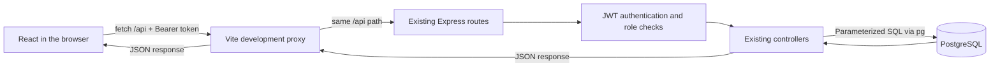

# Consultify V1 frontend

This is the real React interface for the frozen Consultify Express API. It supports Finance only. Data comes from Express and PostgreSQL; there are no mock API responses, seeded public testimonials, or fabricated business statistics.

## Start the application

Use Node.js 24 (the version verified here). Install the backend's locked dependencies from the repository root if necessary:

```sh
npm ci
```

1. Start Docker Desktop, then start the existing PostgreSQL service from the repository root:

   ```sh
   docker compose up -d postgres
   ```

   Compose publishes PostgreSQL on `127.0.0.1:5433`. Keep your existing root `.env`; it supplies the development database URL, JWT secret, and Docker password. Do not put those values in the frontend. The backend requires migrations 001–005 to have been applied. If this is a fresh installation, verify the target database before applying migrations once in order; do not rerun table creation against an existing populated database. Starting React does not create or reset database tables.

2. In one terminal, from the repository root:

   ```sh
   npm run dev
   ```

   Express normally listens at **http://localhost:8000** (or root `.env` PORT).

3. In another terminal:

   ```sh
   cd frontend
   npm ci
   npm run dev
   ```

   Open **http://127.0.0.1:5173**. Vite prints the actual URL if the default port is occupied. Keep both terminals running.

The development proxy target is `http://127.0.0.1:8000`. If your Express PORT is different, start Vite with the corresponding target, for example:

```sh
CONSULTIFY_API_TARGET=http://127.0.0.1:8001 npm run dev
```

This is a server-side Vite setting, not a credential or an API address embedded in components. All browser API requests use relative `/api/...` paths; the proxy preserves `/api`.

## What runs where?



React renders the screen and handles form input, navigation, loading, errors, and temporary state. `fetch()` sends an actual HTTP request; it does not query PostgreSQL directly. The Vite server forwards `/api` requests to Express, so the browser talks to its own origin during development. Express validates the request, checks identity/permissions, and reads or writes PostgreSQL. Its JSON response becomes React state, which updates the page.

For example: `BookingForm` calls `appointmentsApi.book()`. The API client sends `POST /api/appointments`. Express creates a PENDING appointment. React only displays booking success after the successful server response. The appointments screen later fetches the stored row. Cancel/confirm/complete/delete actions use a confirmation dialog and reload server data after success; no permanent optimistic state substitutes for a failed mutation.

## Structure

```text
frontend/
  index.html                  Browser document, title and description
  vite.config.js              React plugin and /api development proxy
  src/
    main.jsx                  React mount, router, auth provider, error boundary
    App.jsx                   All public and role-protected page routes
    api/
      client.js               Relative fetch, JSON, errors, token attachment
      auth.api.js             Registration, login, current user
      advisors.api.js         Directory, details, profiles, review summaries
      appointments.api.js     Booking, scoped lists, lifecycle mutations
      community.api.js        Posts, comments, helpful and owner deletion
      reviews.api.js          Eligible review submission
    context/AuthContext.jsx   User, session restoration, expiry and logout
    hooks/useResource.js      Abortable server reads, loading, errors, retry
    components/
      Layout.jsx              Responsive role-aware navigation/footer
      Guard.jsx               Login destination, restore retry, role checks
      common.jsx              Accessible fields, notices, skeletons, dialogs
    pages/
      Home.jsx                Product introduction; no fabricated statistics
      Auth.jsx                User/advisor signup and login
      Advisors.jsx            Search, profiles, booking, profile management
      Appointments.jsx        Scoped lists, transitions, cancellation, reviews
      Community.jsx           Feed, search, new post, detail and interactions
      Dashboard.jsx           Real appointment summaries and account details
    utils/format.js           Local dates, fees and initials
    styles/main.css           Responsive shared visual system
  scripts/run-integration.cjs  Disposable PostgreSQL + Express + Vite runner
  tests/browser.mjs           Actual Chrome browser workflows
```

API calls live in `src/api`, rather than being repeated inside presentation components. No Redux or UI component library is required. Styling uses CSS variables, responsive grids, semantic forms, visible keyboard focus, native accessible dialogs, and reduced-motion support. Vite handles JSX and builds static assets; it does not replace Express.

## Authentication and roles

- Normal signup uses `/api/auth/register`; advisor signup uses `/api/auth/register/advisor`. Neither form sends a role field, and registration does not issue a token. Successful signup goes to login.
- Login saves the returned JWT in **sessionStorage**, and `AuthContext` holds the safe user data in React state. Passwords and JWTs are never logged or added to the URL.
- The API client attaches `Authorization: Bearer ...` only for protected requests. Public browsing does not require a token.
- On browser refresh, the provider restores the current user through `/api/auth/me`. Protected routes wait for that request. A network failure offers a retry rather than pretending the token is invalid.
- A token expiry timer and protected-request 401 handling clear the session and explain that sign-in is needed. The timer reads the expiry claim for UX; Express remains the authority that verifies the signature and permissions.
- Log out clears the token and user state. This is local logout: the backend does not have revocation/refresh-token APIs. Browser history cannot bypass the route guards.
- USER and ADVISOR navigation/actions differ. Wrong-role routes show a forbidden state; unauthenticated routes preserve the intended destination through sign-in where appropriate.

**Security tradeoff:** sessionStorage is per-tab and survives refresh, but JavaScript on the same origin can read it. An XSS vulnerability could steal the token. React renders user content as text, not raw HTML, but sessionStorage is not production-grade session security. No JWT secret, database URL, or database password belongs in a Vite environment variable or browser bundle. Token persistence, production CSP, HTTPS, and any future server-managed session design need separate review.

## Screens and actual API contracts

The current contract is [BACKEND_TEST_REPORT.md, section I](../docs/BACKEND_TEST_REPORT.md#i-frontend-api-contract-audit), together with the actual backend routes/controllers. Historical master-spec sections may contradict the frozen API.

| Screen                      | Frontend route                             | Backend calls                                                       |
| --------------------------- | ------------------------------------------ | ------------------------------------------------------------------- |
| Signup/login                | `/register`, `/register/advisor`, `/login` | POST auth/register, auth/register/advisor, auth/login; GET auth/me  |
| Advisor directory           | `/advisors`                                | GET `/api/advisors?domain=FINANCE&search=...`                       |
| Advisor profile and booking | `/advisors/:id`                            | GET advisor detail/reviews; POST `/api/appointments`                |
| Professional profile        | `/advisor/profile`                         | GET advisors; POST/PATCH `/api/advisors/profile`; GET reviews       |
| Personal overview           | `/dashboard`                               | GET role-specific appointments; advisors for own-profile lookup     |
| User appointments/reviews   | `/user/appointments`                       | GET appointments/user; PATCH `:id/cancel`; POST reviews             |
| Advisor appointments        | `/advisor/appointments`                    | GET appointments/advisor; PATCH `:id/status`                        |
| Community feed              | `/community`                               | GET community/posts with FINANCE/search filters                     |
| New discussion              | `/community/new`                           | POST community/posts                                                |
| Discussion                  | `/community/:id`                           | GET post/comments; POST comments/helpful; DELETE owned post/comment |
| Account                     | `/account`                                 | AuthContext's safe user, restored via GET auth/me                   |

Important mappings:

- The advisor account's `users.id` is different from `advisor_profiles.id`. Own-profile management looks up `user_id` in the real advisor list. Detail, booking and review URLs use the **profile ID**. There is no invented profile/me API.
- Profile request fields use `experienceYears` and `consultationFee`; responses use `experience_years` and `consultation_fee`.
- Fees may be PostgreSQL NUMERIC strings. They are formatted numerically. The backend declares no currency, so the frontend does not invent a currency symbol or payment system.
- Public posts/comments use `author_id`; creation responses use `user_id`. Ownership controls use the public author IDs after refreshing server data. Helpful/comment counts may be strings and are converted with `Number()`.
- Booking converts the browser's local date/time to an ISO instant using `toISOString()` and previews the selected local time. A frontend guard prevents accidentally requesting a past time, but it does not represent an availability/reservation system or change backend policy.
- USER can cancel PENDING/CONFIRMED appointments. ADVISOR can confirm PENDING or complete CONFIRMED appointments. The backend enforces these transitions atomically.
- Completed appointments show a review action. No `hasReviewed` field is invented: duplicates return 409 and receive a clear message. Reviews and ratings are fetched from the public review endpoint.
- Helpful is add-only. Duplicate votes show an informational message; there is no invented unlike button.

## Debug a request

Open browser developer tools → **Network**, filter by `api`, then perform an action. Inspect the method, `/api/...` URL, response status and JSON response. A 400 means invalid input, 401 means sign-in is missing/expired, 403 means role/ownership denial, 404 means missing or unavailable resource, and 409 means a duplicate. Unexpected/network failures are shown with a retry where relevant. A successful form should not display success for a failed response.

If requests return 502 or fail to connect, check that PostgreSQL and Express are running and that Vite points to the actual Express port. Test `http://127.0.0.1:5173/api/health`; it should return `{"status":"ok","database":"connected"}`. Never paste the Authorization header, password field, environment contents, or raw session storage into issue reports.

## Build and real browser integration tests

From `frontend/`:

```sh
npm run build
npm run test:integration
```

The browser test command requires the backend dependencies installed at the repository root and local PostgreSQL `initdb`, `pg_ctl`, and `postgres` binaries on PATH. It creates a **fresh temporary cluster/database**, verifies the database identity and empty public schema, applies the unchanged five migrations, starts the real Express app and Vite proxy on temporary ports, and drives actual browser forms in separate USER/ADVISOR/public contexts. It never reads the root `.env` or uses the development database. It does not drop databases or remove Docker volumes. It stops its own servers/cluster afterward and retains temporary cluster files.

Tests use system Google Chrome on macOS if present. Otherwise install Playwright's Chromium once with `npx playwright install chromium`, then rerun. Playwright is a development-only dependency; no browser is downloaded by the application or required by end users. Restricted environments may require permission for PostgreSQL shared memory and browser/listener startup.

Results and screenshots go to ignored `frontend/test-results/`. They contain disposable test data, not real user data. Do not commit generated results, screenshots, databases or credentials. To retain a temporary isolated review server after the checks pass:

```sh
npm run test:integration -- --serve
```

The command prints a temporary preview URL. Ctrl+C stops its owned servers and cluster. This is for local review with disposable data, not a production deployment.

## Production and known V1 limits

`npm run build` produces `frontend/dist/`. Production needs an ordinary static host with a SPA fallback to `index.html`, plus a same-origin reverse proxy for `/api` to Express. Vite's development proxy is not production infrastructure. Separate origins would require an explicitly approved backend CORS policy. Deployment, TLS, backups, database credentials, rate limiting and browser token security still need deployment review.

The backend contract remains frozen at commit `937d873bb2ceaa610fce776ecd778c0bf346f7ac`. Its production files, migrations, root environment and package manifests are untouched by this frontend implementation. Only PostgreSQL 18.6 has been runtime-tested here; Compose's PostgreSQL 17.4 still needs runtime verification. Advisor onboarding is self-service, without professional verification. There are no payments, chat/calls, notifications, calendar sync, availability APIs, admin features, pagination, account editing or password recovery. Long feeds are returned according to the existing backend; the frontend adds no fake pagination guarantees.
